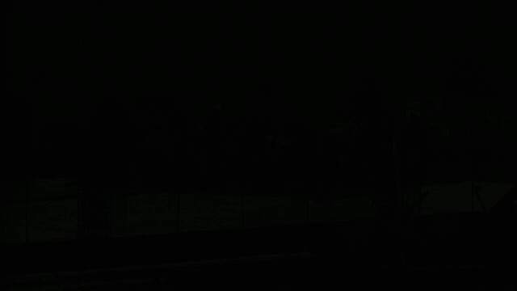

# Worker-Fall-Detection Project

### YOLO Pose detecting construction workers



### Setup

You can create a virtual env if you want

Install dependencies:

```bash
pip install -r requirements.txt
```

### Run

From the project root, run:

```bash
python src/yolo_pose.py --input data/input/YourVideo.mp4 --model models/yolo11n-pose.pt
```

Team Members: Johnathan Miller, Evan Gruhlkey, Malcom Troy, Allen Basil, Benjamin Aleman

Sponsor: Maksym Pryporov - Maksym_Pryporov@oxy.com

Our group is tasked with building a computer vision safety software that can detect and see when workers are falling, and trigger an alarm when it occurs.
