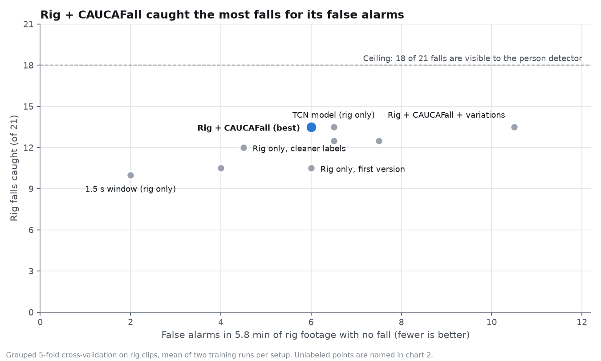
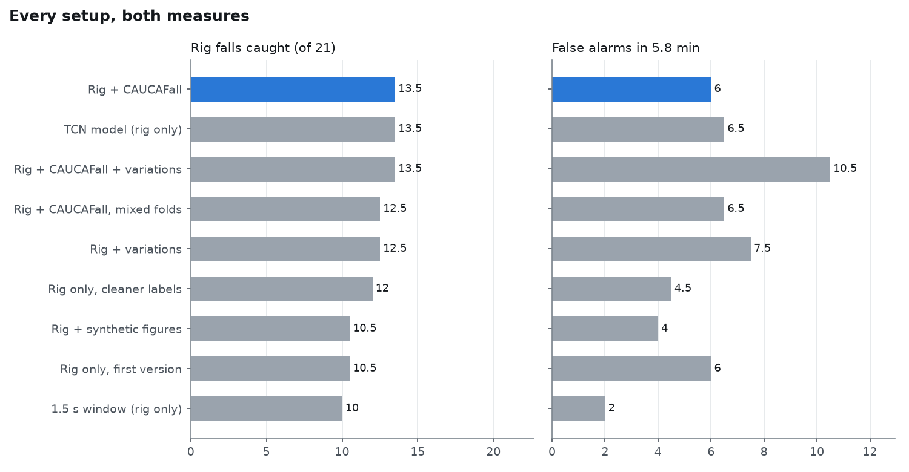
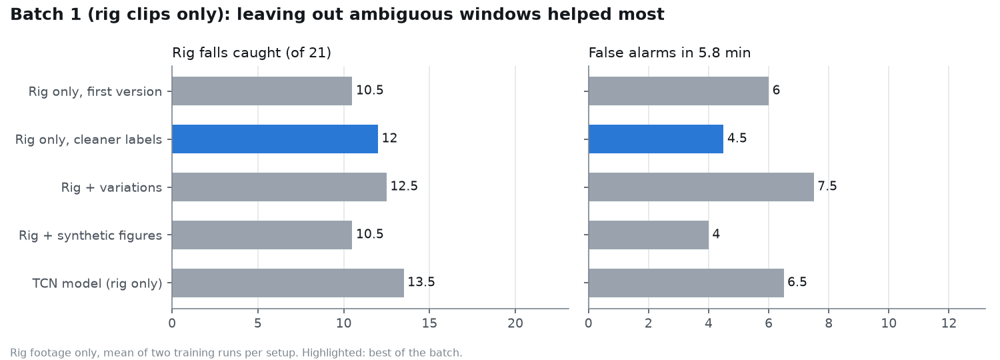
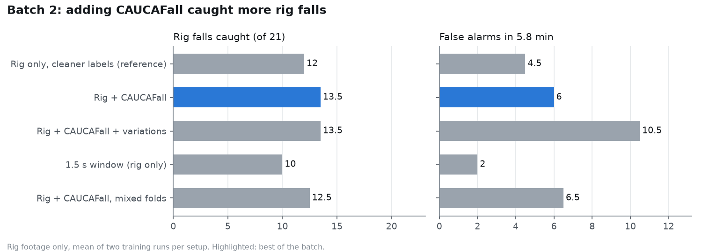
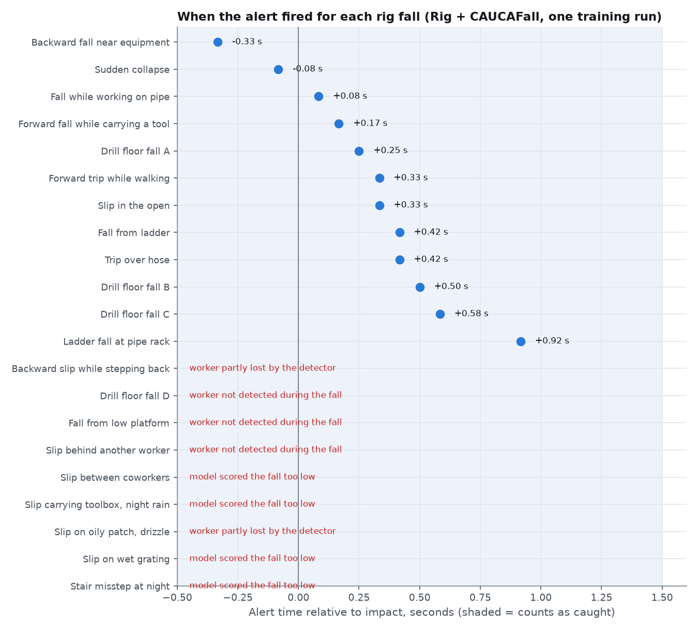
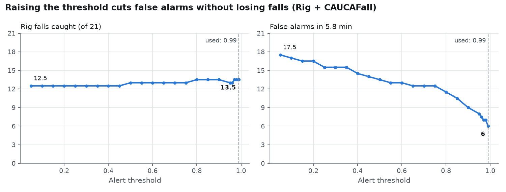

# Worker Fall Detection: Temporal Model Training, Trial 1

*Training runs of 5 November 2026. Figures are in `reports/2026-11-05_trial1/charts/`; example videos and stills are listed in section 4.4.*

---

## 1. Project overview

The system watches existing rig CCTV cameras and raises an alert when a worker falls. It works in three stages.

1. **Pose extraction.** Each video frame goes through a person detector (YOLO26n), a tracker that gives every worker a stable ID across frames (ByteTrack), and a pose model (RTMPose-t) that finds 17 body joints per person: head, shoulders, elbows, wrists, hips, knees and ankles. The video is processed at 12 frames per second.
2. **Temporal model (the subject of this trial).** For each tracked worker, a small neural network watches the last 2.5 seconds of that person's joint positions (30 frames) and outputs a fall probability between 0 and 1. It sees motion, not images: joint positions, joint speeds and accelerations, the shape of the person's bounding box, and five fall signals (hip height, head height, torso angle, and how fast the hips and head are dropping). The network is a GRU, a type of recurrent network suited to short time series, with about 37,000 parameters. It runs comfortably on a CPU.
3. **Alert rule.** An alert fires when a person's fall probability stays above a threshold for 5 consecutive frames (0.4 s). After an alert, the same person cannot trigger another for 30 seconds.

Working from joint positions rather than raw pixels has two advantages. The model does not depend on lighting, clothing or background, which vary a lot between rigs. And no images need to be stored or sent anywhere to make a decision.

**Goal of this trial:** find out how well the temporal model can catch falls on rig footage, how many false alarms it raises, and which training choices help most.

---

## 2. Training data

### 2.1 Sources

| Source | Clips | With a fall | Without a fall | Footage | Used for |
| --- | --- | --- | --- | --- | --- |
| Rig clips (AI-generated oil rig footage) | 31 | 21 | 10 | 6.6 min | Training and testing |
| CAUCAFall (public research dataset) | 100 | 50 | 50 | 16.6 min | Training only (batch 2) |

**Rig clips.** 36 clips of oil rig workers were generated with AI video tools; 5 were dropped because the AI-generated motion was physically unrealistic. The 21 fall clips cover slips (7), trips (2), loss of balance (3), ladder falls (2), a stair misstep, and more.vThe 10 normal work clips show routine maintenance, including workers kneeling, crouching and lying on their backs under pipework, which are exactly the poses most likely to look like a fall.

**CAUCAFall** (Universidad del Cauca, CC BY 4.0) adds 10 real people filmed by a single camera high in a room corner, in daylight and in night-vision mode. Each person performs five falls (forward, backward, left, right, and falling from a chair) and five everyday movements (walking, hopping, kneeling, sitting down and picking up an object).

### 2.2 Labeling

- Every fall was timed by hand, frame by frame: **start** = the moment the person loses balance, **end** = impact with the ground. Rig falls last a median 0.6 s (0.3 to 1.0 s); CAUCAFall falls a median 0.7 s. Twelve CAUCAFall falls are slow and controlled (the person kneels down first) and are flagged.
- In clips with several workers, the person who falls is identified by their tracker ID, so coworkers standing nearby are not labeled as falling.
- Clips filmed in the same scene are grouped, so a scene is never split between training and testing. Otherwise near-identical clips would inflate the test score.

### 2.3 How clips become training examples

Each clip is cut into overlapping 2.5 s windows, one ending at every frame, for every tracked person. A window is a **fall example** when it contains more than half of a labeled fall, and a **normal example** when it contains none of it.

| Source | Fall examples | Normal examples |
| --- | --- | --- |
| Rig clips | 433 | 7,916 |
| CAUCAFall | 603 | 5,516 |

Falls are rare in the data (about 1 window in 17), so fall examples are weighted more heavily during training.

---

## 3. How the models were tested

Every number in this report comes from **grouped 5-fold cross-validation**. The 31 rig clips were divided into 5 groups by scene. Each group was held out in turn while a model trained on the other four, then that model was tested on the held-out clips. Every rig clip was therefore tested exactly once, by a model that had never seen it or anything filmed in the same scene.

- **Each setup was trained twice** with different random starting points and the results averaged, which is why some counts end in .5.
- **Testing replays the full live system** on each held-out clip: tracking, the 0.4 s alert rule and the 30 s cooldown, exactly as deployed.
- **A fall counts as caught** when an alert fires for the person who fell, between 0.5 s before the fall starts and 1.5 s after impact.
- **A false alarm** is any other alert, on anyone, in the 5.8 minutes of rig footage outside those fall moments.
- **The alert threshold** is chosen per setup: the one with the fewest false alarms, then the most falls caught.
- **CAUCAFall is never part of the test.** All headline numbers are on rig footage only, so every setup is compared on the same 21 falls.

---

## 4. Results

### 4.1 Summary

The best setup, **Rig + CAUCAFall**, caught **13.5 of 21 rig falls (64%)**, alerting a median **0.17 s after impact**, with **6 false alarms in 5.8 minutes** of footage with no fall.

*Figure 1. Every setup tested, falls caught against false alarms. Better setups sit up and to the left. The dashed line marks the most falls any model could catch with the current person detector (18 of 21).*

*Figure 2. The same results as bars, with every setup named.*

### 4.2 Batch 1: rig clips only

Batch 1 trained on the 31 rig clips alone and changed one thing at a time.

| Setup | What changed | Falls caught (of 21) | False alarms | On normal-work clips | Median alert after impact |
| --- | --- | --- | --- | --- | --- |
| Rig only, first version | Starting point | 10.5 | 6 | 3 | +0.40 s |
| **Rig only, cleaner labels** | Ambiguous windows left out (see below) | **12** | **4.5** | 2.5 | +0.19 s |
| Rig + variations | 3 altered copies of every training clip | 12.5 | 7.5 | 4 | +0.15 s |
| Rig + synthetic figures | 200 computer-generated stick-figure clips added | 10.5 | 4 | 1.5 | +0.02 s |
| TCN model | A convolutional network instead of the GRU | 13.5 | 6.5 | 3.5 | +0.06 s |

*Figure 3. Batch 1 results.*

**What batch 1 showed**

- **Cleaner labels helped the most.** In the first version, a window holding up to half of a fall was labeled "no fall", which taught the model that the start of a fall is normal movement. Leaving those ambiguous windows out of training caught 1.5 more falls with 1.5 fewer false alarms, and the alert came 0.2 s sooner. Every later setup keeps this change.
- **Altered copies of the clips** (mirrored, slightly tilted, sped up or slowed down) made the model rank falls better overall but raised false alarms from 4.5 to 7.5.
- **Synthetic stick figures did not help.** Their motion is too clean and regular to teach the model much about real people.
- **The TCN** caught as many falls as the best batch 2 setup, but ranked falls against normal movement worst of all setups (0.58 against 0.67 for the GRU). Its catch rate depends heavily on the exact threshold, so we kept the GRU.

### 4.3 Batch 2: adding CAUCAFall

Batch 2 kept the cleaner labels and tested whether the 100 CAUCAFall clips help the model on rig footage. "Rig only, cleaner labels" is repeated as the reference.

| Setup | What changed | Falls caught (of 21) | False alarms | On normal-work clips | Median alert after impact |
| --- | --- | --- | --- | --- | --- |
| Rig only, cleaner labels | Reference (same as batch 1) | 12 | 4.5 | 2.5 | +0.19 s |
| **Rig + CAUCAFall** | CAUCAFall added to training | **13.5** | **6** | 4 | +0.17 s |
| Rig + CAUCAFall + variations | Plus 3 altered copies of every clip | 13.5 | 10.5 | 7.5 | +0.04 s |
| 1.5 s window | The model watches 1.5 s instead of 2.5 s | 10 | 2 | 1 | +0.08 s |
| Rig + CAUCAFall, mixed folds | CAUCAFall also rotated into the test groups | 12.5 | 6.5 | 5 | +0.25 s |

*Figure 4. Batch 2 results.*

**What batch 2 showed**

- **CAUCAFall helped.** It caught 1.5 more rig falls and ranked falls better overall (0.73 against 0.67), at the cost of 1.5 more false alarms. Falls in five directions by ten different people taught the model what a fall looks like more generally than 21 AI-generated clips could.
- **Adding altered copies on top of CAUCAFall** did not catch more falls and raised false alarms to 10.5, the worst of any setup.
- **The 1.5 s window** raised the fewest false alarms of any setup (2) but caught only 10 falls at its chosen threshold. At a lower threshold (0.5) it caught 14.5, the most of any setup. A shorter view of the past means less time looking at a worker who is simply lying still, which suggests this setup is worth tuning further.
- **Mixing CAUCAFall into the test groups** gave similar rig results (12.5 caught). It also showed how the model does on CAUCAFall itself: 22.5 of 50 falls caught, with 2 false alarms in 14 minutes of CAUCAFall footage.

### 4.4 The best setup, fall by fall

*Figure 5. For each rig fall, when the alert fired relative to impact, in the training run used for the example videos (12 of 21 caught). The shaded band is the window in which an alert counts as caught.*

Of the 21 rig falls, **13 were caught by both training runs, 1 by one run and 7 by neither.**

- **Caught:** sudden collapse, forward trip, fall while working on a pipe, forward fall carrying a tool, both ladder falls, three of the four drill floor falls, trip over a hose, slip in the open, backward fall near equipment and slip between coworkers. Alerts fired between 0.4 s before and 0.6 s after impact.
- **Missed, fall visible:** slip on wet grating and slip carrying a toolbox at night in rain. The model scored these falls too low.
- **Missed, worker partly lost by the detector:** slip on an oily patch in drizzle and backward slip while stepping back.
- **Not visible to the model:** drill floor fall D, fall from a low platform and slip behind another worker. The person detector loses the worker during the fall, so the temporal model never sees it.

**Example videos.** To show the results on video, the best setup was trained once more with the same settings, and every rig clip was rendered as its held-out model saw it. That run caught 12 of 21 falls and raised 4 false alarms, within the normal run-to-run spread of the two runs reported above (13.5 and 6 on average). Each annotated video shows skeletons and boxes for every tracked worker, each worker's fall score, the labeled fall, and a timeline of scores under the picture. A green banner marks a correct alert; a red banner marks a false alarm.

All paths below are inside `reports/2026-11-05_trial1/`.

| Example | What it shows | Annotated result video | Still image |
| --- | --- | --- | --- |
| Sudden collapse | Clean catch: alert 0.08 s before impact; nine coworkers all stay at 0.00 | `videos/caught/sudden_collapse.mp4` | `stills/sudden_collapse_06.58s.jpg` |
| Backward fall near equipment | Alert 0.33 s before impact | `videos/caught/backward_fall_near_equipment.mp4` | `stills/backward_fall_near_equipment_10.42s.jpg` |
| Fall from ladder | Caught from an elevated position, after a tracker ID change mid-fall | `videos/caught/fall_from_ladder.mp4` | `stills/fall_from_ladder_08.50s.jpg` |
| Trip over hose | Caught with several workers in view | `videos/caught/miller_group_fall_02_trip_over_hose.mp4` | `stills/miller_group_fall_02_trip_over_hose_05.17s.jpg` |
| Slip on wet grating | Missed although visible: the score never reaches the threshold | `videos/missed/miller_group_fall_01_slip_wet_grating.mp4` | `stills/miller_group_fall_01_slip_wet_grating_06.42s.jpg` |
| Slip between coworkers | Missed in this run, caught in both reported runs: run-to-run variation | `videos/missed/slip_between_coworkers.mp4` | `stills/slip_between_coworkers_07.67s.jpg` |
| Slip behind another worker | The faller is hidden and never tracked; a new ID appears where they fell and alerts, counted as a false alarm | `videos/not_visible/slip_behind_person.mp4` | `stills/slip_behind_person_08.08s.jpg` |
| Normal work 2 | False alarm on a worker crouched low at a pump | `videos/normal_work/29jB-BibMmaRAZBqZtNnU_alligator.mp4` | `stills/29jB-BibMmaRAZBqZtNnU_alligator_14.92s.jpg` |
| Normal work 6 | False alarm on a small, distant worker at the top of the stairs | `videos/normal_work/jrigd_ZgdOhh4j67tzGVU_alligator.mp4` | `stills/jrigd_ZgdOhh4j67tzGVU_alligator_02.75s.jpg` |
| Ladder fall at pipe rack | False alarm at 3.1 s on a second, partial box over one worker; the real fall at 7 s is then caught | `videos/caught/miller_group_fall_04_ladder_fall_pipe_rack.mp4` | `stills/miller_group_fall_04_ladder_fall_pipe_rack_03.08s.jpg` |
| Normal work 1 | Workers lying under pipework; false alarms in the reported runs, none in this run | `videos/normal_work/1xiFn4bLdT-6Alz7z0XDz_alligator.mp4` | `stills/original_runs_false_alarms_lying_workers.jpg` |

All 31 annotated videos are in `videos/`, sorted into `caught/` (12), `missed/` (6), `not_visible/` (3) and `normal_work/` (10). Still images at every alert and every missed impact are in `stills/`. The per-clip results behind the videos are in `data/examples.csv`. The original clips and the pose-tracking videos (skeletons and track IDs, no scores) are on GitHub in `data/input/` and `data/output/`.

### 4.5 The alert threshold

*Figure 6. Best setup: falls caught and false alarms at each alert threshold.*

Raising the threshold from 0.05 to 0.99 cut false alarms from 17.5 to 6 while falls caught stayed between 12.5 and 13.5. Almost every setup chose 0.99, the highest value tested. The model gives both real falls and some workers lying still a probability close to 1.0, so the threshold alone cannot separate them.

### 4.6 What caused the good and the bad results

**Why the model works on clear falls**

- **Falls have a strong motion signature.** Hips and head drop fast, the torso swings toward horizontal and the bounding box goes from tall to wide, all within about a second. These are the signals the model is given directly, and on clearly visible falls it picks them up reliably and quickly: a median 0.17 s after impact.
- **Cleaner labels** removed contradictory training examples (the start of a fall labeled "no fall").
- **CAUCAFall** added variety the rig clips lack: 10 real people, five fall directions, and real everyday movements such as kneeling and sitting down.
- **Following workers through ID changes.** When the tracker gives a falling worker a new ID mid-fall, both training and live detection hand the history over to the new ID. This alone raised the number of usable rig fall examples from 293 to 433.

**Why falls are missed**

- **The person detector loses workers while they fall.** YOLO26n is the smallest model in its family. It struggles with people seen from a high angle, partly hidden behind equipment or coworkers, or in the unusual body positions of a fall. On CAUCAFall nobody was detected in 40% of fall frames, and running the detector on those frames gave a best person confidence of mostly 0.00. Five of the 7 missed rig falls trace back to this, and 3 of them give the temporal model nothing to work with. This limits the live system in the same way.
- **Too few falls in each condition.** Night, rain and wet-grating slips appear only once or twice among the 21 rig falls, and each test model has seen at most a handful of similar falls.

**Why false alarms happen**

The false alarms we inspected have three causes.

- **Workers lying, kneeling or crouching on purpose look like the end of a fall.** This is the most common cause: workers lying under pipework in the reported runs (see `stills/original_runs_false_alarms_lying_workers.jpg`), and a worker crouched at a pump in the example run. A 2.5 s window that ends just after a fall shows a person low on the deck, so the model learned that a person low on the deck usually means a fall. Only the 10 normal-work clips show workers getting down deliberately, which is not enough to unlearn it.
- **Glitches in detection and tracking.** In the example run, one alarm came from the detector putting a second, partial box over a standing worker, and one from a small, distant worker whose box and joints jump from frame to frame. To the model, a box that suddenly shrinks or a skeleton that jumps looks like a body dropping.
- **A fall the tracker could not link.** In "Slip behind another worker", the hidden worker falls, a new ID appears where they fell and the alert fires during the fall. The tracker could not connect it to the worker who fell, so it counts as a false alarm, although it is close to a catch.
- **The model is overconfident.** With a small dataset, it scores most windows near 0 or near 1. Raising the threshold therefore cannot separate falls from lying workers.
- **Altered copies and synthetic figures** add more variety in falls but no new examples of deliberate lying, so they raise false alarms rather than lower them.

**Why the numbers move between setups**

With 21 test falls, one fall caught or missed changes the rate by about 5 percentage points. Two training runs of the same setup often differ by one or two falls: the extra run made for the example videos caught 12 rather than the reported average of 13.5. Differences of one or two falls between setups are within this noise; the clear signals are the cleaner labels, CAUCAFall, and the false alarms on workers low on the deck.

### 4.7 Limits of this trial

- **The rig footage is AI-generated.** Results on real rig cameras may differ.
- **The false-alarm footage is short and deliberately hard:** 5.8 minutes, much of it workers lying under equipment. It cannot yet show the target of under one false alarm per hour of normal work.
- **The live system still runs an older pose model** (YOLO11n-pose). It must be switched to the pipeline used here before this model is deployed.
- **No final model has been trained yet.** These are cross-validation results, which estimate how a model trained on all the data would perform on new footage.

---

## 5. Next steps

In priority order:

1. **Add footage of workers lying, kneeling and crouching on purpose:** under pipes, at valves, beside pumps, and getting up again. Aim for at least as many minutes as the fall footage. This targets the main source of false alarms.
2. **Test a larger person detector** (YOLO26s or YOLO26m) on the falls where the worker is lost. This raises the 18-of-21 ceiling, in testing and in the live system.
3. **Add more falls in hard conditions:** night, rain, wet and oily decks, and workers partly hidden by equipment or coworkers.
4. **Clean up detection glitches before they reach the model:** merge boxes that overlap the same worker, ignore very small or very unstable tracks, and link a new track that appears where a worker just fell to that worker.
5. **Teach the model the difference between falling and lying still.** For example, require a fast drop of the hips or head before an alert can fire, or give the model a little more time before the fall so it sees the person upright first.
6. **Tune the 1.5 s window** together with CAUCAFall. It raised the fewest false alarms and, at a lower threshold, caught the most falls.
7. **Switch the live system to the same pose pipeline** (YOLO26n + ByteTrack + RTMPose-t at 12 fps) so the deployed model sees the same kind of joint data it was trained on.
8. **Test on real rig camera footage,** including staged falls onto mats and long stretches of normal work, to confirm the results carry over and to measure false alarms per hour.
9. **Train the final model** on all clips with the best setup, then repeat this comparison after steps 1 and 2.

---

*CAUCAFall: J. C. Eraso, E. Muñoz, M. Muñoz and J. Pinto, Universidad del Cauca, doi:10.17632/7w7fccy7ky.4, licensed CC BY 4.0. Fall times were re-labeled and poses extracted by the project team.*
