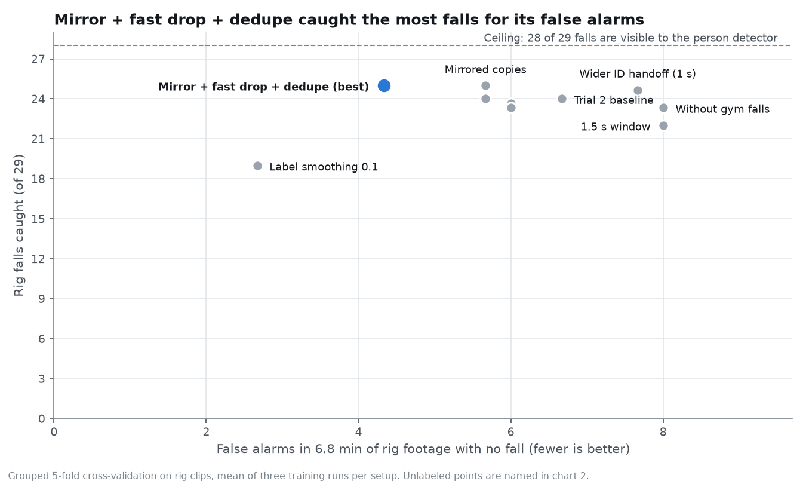
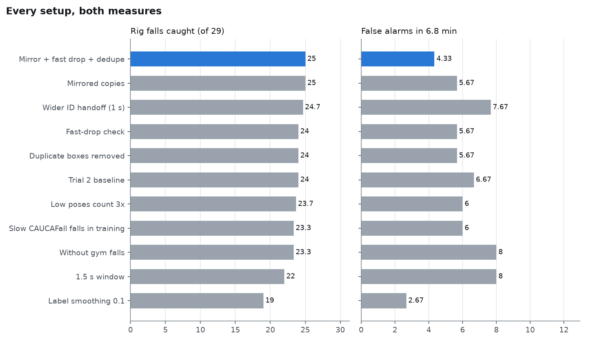
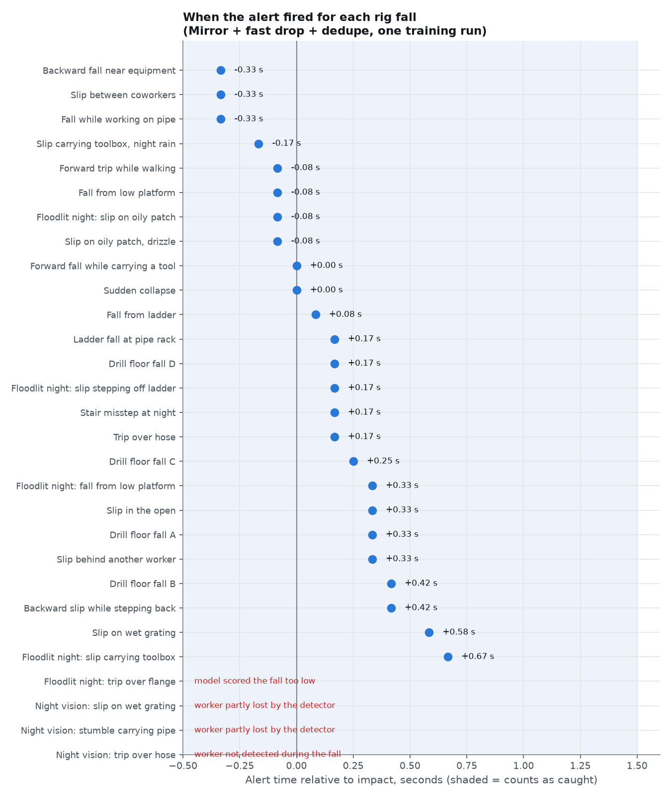
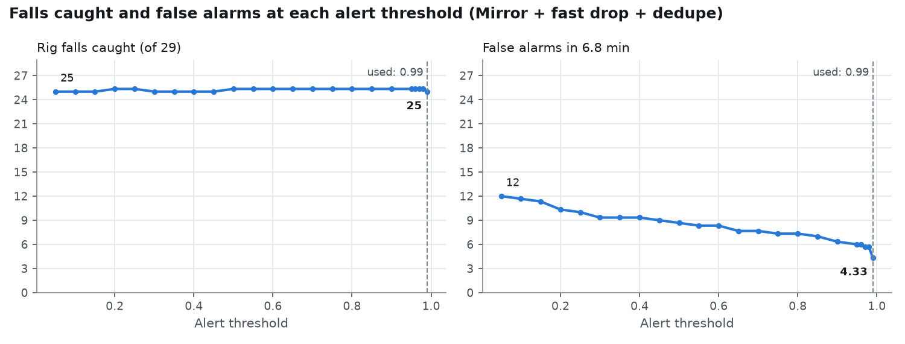

# Worker Fall Detection: Temporal Model Training, Trial 2

*Training runs of 15 and 16 November 2026. Figures are in `reports/2026-11-16_trial2/charts/`; example videos and stills are listed in section 4.4. Trial 1's write-up is `reports/2026-11-05_trial1/WRITEUP.md`.*

---

## 1. Summary

Trial 2 set out to catch more falls and raise fewer false alarms than Trial 1. On the same 21 rig falls Trial 1 was scored on, the best Trial 2 setup:

- **caught 20.3 of 21 falls (97%)**, up from 13.5 (64%), and
- **raised 4.3 false alarms** in the same 5.8 minutes of footage with no fall, down from 6.

Including the 8 new night falls, it caught **25 of 29 rig falls (86%)**, with 4.3 false alarms in 6.8 minutes. Every one of the 4 falls it missed is at night, and 3 of the 4 are in night-vision (infrared) footage.

| | Trial 1 best (Rig + CAUCAFall) | Trial 2 best (Mirror + fast drop + dedupe) |
| --- | --- | --- |
| Person detector | YOLO26n | **YOLO26m** |
| Falls caught, Trial 1's 21 rig falls | 13.5 (64%) | **20.3 (97%)** |
| False alarms, same 5.8 min of footage | 6 | **4.3** |
| Falls caught, all 29 rig falls (with night) | not tested | **25 (86%)** |
| Median alert time after impact | +0.17 s | +0.17 s |
| Falls where the detector sees the worker fall | 18 of 21 | 21 of 21 (28 of 29) |
| Training runs averaged per setup | 2 | 3 |

The single biggest change was the **larger person detector**. Trial 1 lost the worker in a quarter of fall frames. YOLO26m sees them in 97% of fall frames, so the temporal model now gets to see almost every fall. On top of that, three training and tracking changes each removed about one false alarm, and together they removed more than two (section 4.2).

---

## 2. What changed since Trial 1

### 2.1 The pose pipeline: YOLO26n to YOLO26m

The system works in three stages, as in Trial 1. First a person detector and tracker (ByteTrack) give every worker a box and an ID. Then a pose model (RTMPose-t) finds their body joints. Finally the temporal model, a small GRU network, watches 2.5 s of each worker's joint positions and outputs a fall probability. Since Trial 1, the joint loader keeps 12 body joints (shoulders, elbows, wrists, hips, knees, ankles) instead of 17, dropping the five face points.

Trial 1's main conclusion was that most misses came from the person detector, YOLO26n, losing workers while they fell. For Trial 2 the detector was upgraded to **YOLO26m**, the medium model in the same family, and every training video was processed again with it.

| Source | Fall frames in which the falling worker is detected (YOLO26n → YOLO26m) |
| --- | --- |
| Rig clips | 73% → **97%** |
| Team gym clips | 96% → **100%** |
| CAUCAFall | 60% → **77%** |

YOLO26m is about 4 times slower than YOLO26n. On a laptop CPU it runs at about 1.4 frames per second, which is too slow for live use. With a GPU it is fast enough: on the team's test laptop (NVIDIA T600, an entry-level 4 GB GPU) the live dashboard now runs YOLO26m at about 18 frames per second with two people in view, and about 11 with ten. The dashboard uses the GPU automatically and keeps a YOLO26n configuration for computers without one (`models/pose_pipeline_cpu.json`).

### 2.2 New training data

| Source | Clips | With a fall | Without a fall | Used for |
| --- | --- | --- | --- | --- |
| Rig clips, Trial 1 set (AI-generated) | 31 | 21 | 10 | Training and testing |
| **Rig clips, night (AI-generated, new)** | 8 | 8 | 0 | Training and testing |
| **Team gym falls (real, new)** | 22 | 22 | 0 | Training only |
| CAUCAFall (public dataset) | 88 of 100 | 38 | 50 | Training only |

- **Night rig clips.** Ten night clips were generated: five floodlit and five in night-vision (grayscale infrared) as a CCTV camera would record them. Two night-vision clips are still left out because even YOLO26m does not detect the worker during the fall (a ladder fall and a stair tumble). Three of these clips could not be used in Trial 1's pipeline at all, because YOLO26n detected nobody in the night-vision footage.
- **Team gym falls.** Team members recorded 22 clips of themselves falling onto gym mats, filmed with a handheld phone at chest height in two sessions: falls from a height, trips, collapses and falls from sitting. These are real human falls, unlike the AI-generated rig clips. They are used for training only, because the test set must stay rig footage. Two more clips were left out: one is a slow, controlled lean and the other is too short to contain a full fall.
- **CAUCAFall.** The 12 slow, controlled CAUCAFall falls (the person kneels down first) were taken out of training. A worker lowering themselves to the deck on purpose looks very much like these, which risks teaching the model that kneeling down is a fall. Section 4.2 tests this.
- **Labels.** All fall times were checked again by eye. Because the faller's tracker ID depends on the detector, the ID of the person who falls was redone for every clip after the switch to YOLO26m and checked visually.

### 2.3 New training and alert options

Trial 2 added eight options to the training script, each aimed at a cause of misses or false alarms found in Trial 1. Section 4.2 explains each one with its result.

---

## 3. How the models were tested

Testing works exactly as in Trial 1, so the results are directly comparable.

- **Grouped 5-fold cross-validation.** The 39 rig clips are split into 5 groups by scene, and each group is tested by a model that never saw it or anything filmed in the same scene. Gym and CAUCAFall clips are only ever added to training.
- **Each setup was trained 3 times** with different random starting points (Trial 1: twice), and the results averaged, which is why counts end in .3 or .7. Three runs show the run-to-run noise better: one fall caught or missed moves the rate by 3 to 5 percentage points.
- **Testing replays the full live system** on every held-out clip: tracking, the 0.4 s alert rule (5 frames above the threshold) and the 30 s cooldown.
- **A fall counts as caught** when an alert fires for the person who fell, between 0.5 s before the fall starts and 1.5 s after impact. **A false alarm** is any other alert, on anyone, in the 6.8 minutes of rig footage outside those fall moments (5.8 minutes in Trial 1's clips; the night clips add 1.0 minute).
- **Two new columns make the comparison fairer.**
  - **Honest** picks each test group's alert threshold using only the other groups, so the threshold is never tuned on the clips being scored. It is the number to trust when comparing setups.
  - **On Trial 1 clips** scores the same 21 falls and 5.8 minutes as Trial 1, so the two trials can be compared directly.

---

## 4. Results

### 4.1 Overview

*Figure 1. Every Trial 2 setup, falls caught against false alarms. Better setups sit up and to the left. The dashed line marks the most falls any model could catch with YOLO26m: 28 of 29, because one night-vision worker is never detected during the fall.*

*Figure 2. The same results as bars, with every setup named.*

### 4.2 Batch 3: one change at a time

Batch 3 started from a new baseline: Trial 1's best setup, trained on all the new data with YOLO26m poses. Every other setup changed exactly one thing from it.

| Setup | What changed | Falls caught (of 29) | False alarms | Honest (caught, false) | On Trial 1 clips (of 21, false) |
| --- | --- | --- | --- | --- | --- |
| **Trial 2 baseline** | Starting point | 24 | 6.7 | 24, 7.3 | 19.3, 6.7 |
| Without gym falls | Team gym falls left out | 23.3 | 8 | 23.3, 8.7 | 19.3, 8 |
| Slow CAUCAFall falls in training | The 12 slow falls put back | 23.3 | 6 | 23.7, 7 | 19.3, 5.7 |
| 1.5 s window | The model watches 1.5 s instead of 2.5 s | 22 | 8 | 22, 9 | 17.7, 8 |
| **Fast-drop check** | No alert unless the body dropped fast | 24 | **5.7** | 24, 6.7 | 19.3, 5.7 |
| Label smoothing 0.1 | Training targets of 5% and 95% instead of 0% and 100% | 19 | **2.7** | 19.7, 3 | 15.3, 2.7 |
| Low poses count 3x | Kneeling, crouching and lying normal windows weighted 3x | 23.7 | 6 | 23.7, 7 | 19.3, 6 |
| Wider ID handoff (1 s) | A lost track can pass to a new ID up to 1 s later (was 0.4 s) | 24.7 | 7.7 | 24.7, 8.3 | 19.7, 7.7 |
| **Duplicate boxes removed** | A second, smaller box on the same body is dropped | 24 | **5.7** | 24, 7 | 19.7, 5.7 |
| **Mirrored copies** | One left-right mirrored copy of each training clip | **25** | **5.7** | **25.3, 7.3** | **20.3, 5.7** |

**What each change does, and what it showed**

- **Gym falls helped.** Without them the model raised 1.3 more false alarms and caught slightly fewer falls. Falls by real people, even onto mats, teach the model what a real body does when it falls.
- **Leaving out the slow CAUCAFall falls made little difference.** Putting them back cost 0.7 of a catch and saved 0.7 of a false alarm, which is within the noise. They stay out.
- **The 1.5 s window was worse on both counts** with this data, unlike Trial 1, where it gave the fewest false alarms. With YOLO26m, the extra second of history before the fall helps more than it hurts.
- **The fast-drop check** blocks an alert unless the worker's hips or head dropped by at least 15% of their body length within 0.75 s. A worker already lying or kneeling on the deck, with no sudden drop, cannot trigger it. It removed 1 false alarm and cost no catches.
- **Label smoothing** tells the model during training that a fall window is "95% fall" rather than "100%". This stops it scoring almost everything as 0 or 1. It cut false alarms by 60%, the most of any change, but missed 5 more falls at the same threshold.
- **Weighting low poses 3x** targeted Trial 1's main cause of false alarms, workers deliberately low on the deck. It helped a little (0.7 fewer false alarms) but cost a little too (0.3 fewer catches).
- **The wider ID handoff** caught the most falls after mirroring, by following workers through longer tracking gaps. It also stitched together different people more often, which added a false alarm.
- **Removing duplicate boxes** fixes a detector glitch Trial 1 found: a second, partial box on a standing worker looks like a body suddenly shrinking. It removed 1 false alarm.
- **Mirrored copies** double the variety of falls (a fall to the left becomes a fall to the right) without changing how the motion looks. This was the best single change: 1 more fall caught and 1 fewer false alarm. In Trial 1, a mix of mirroring, tilting and speed changes raised false alarms. Mirroring alone does not distort the motion, so it adds variety without teaching anything false.

### 4.3 Batch 4: the best changes combined

Batch 4 combined the three changes that helped without a trade-off: **mirrored copies, the fast-drop check and duplicate-box removal**.

| Setup | Falls caught (of 29) | False alarms (6.8 min) | Honest (caught, false) | On Trial 1 clips (of 21, false) | Median alert after impact |
| --- | --- | --- | --- | --- | --- |
| Trial 2 baseline | 24 | 6.7 | 24, 7.3 | 19.3, 6.7 | |
| **Mirror + fast drop + dedupe** | **25** | **4.3** | **25, 4.7** | **20.3, 4.3** | +0.17 s |

The combined setup kept mirroring's 25 catches and brought false alarms down to 4.3, the lowest of any setup that did not lose catches. All three training runs caught exactly 25 falls. False alarms were 4, 3 and 6, so differences of 1 or 2 false alarms between setups are within the noise.

### 4.4 The best setup, fall by fall

*Figure 3. For each rig fall, when the alert fired relative to impact, in the training run used for the example videos (25 of 29 caught). The shaded band is the window in which an alert counts as caught.*

Over the three reported training runs, **23 falls were caught by every run, 4 by some runs and 2 by none.** All 21 of Trial 1's falls were caught by at least two of the three runs.

- **Caught:** every fall in Trial 1's clip set, including the 7 Trial 1 missed: slip on wet grating, slip carrying a toolbox at night in rain, slip on an oily patch in drizzle, backward slip while stepping back, drill floor fall D, fall from a low platform, and slip behind another worker. Four of five floodlit night falls were also caught. Alerts fired between 0.33 s before and 0.67 s after impact.
- **Missed, model too slow:** the floodlit trip over a flange. The worker trips to their knees, the score peaks at 0.95 during the fall, just under the threshold, and the alert fires 2.2 s after impact, when the worker is lying on the deck. That is too late to count.
- **Missed, worker partly lost by the detector:** night-vision slip on wet grating and night-vision stumble carrying a pipe. In both, the model's score reaches 1.0 at the end of the fall, but the detector loses the worker before the 0.4 s alert rule completes.
- **Not visible to the model:** night-vision trip over a hose. The worker falls behind a coworker and is never detected on the ground.

**Example videos.** As in Trial 1, the best setup was trained once more with the same settings, and every rig clip was rendered as its held-out model saw it. That run caught 25 of 29 falls and raised 4 false alarms, in line with the average of the three reported runs. Each annotated video shows skeletons and boxes for every tracked worker, each worker's fall score, the labeled fall, and a timeline of scores under the picture. A green banner marks a correct alert and a red banner a false alarm. The example run picked its threshold (0.97) from its own held-out results, so it differs slightly from the 0.99 of the reported runs.

All paths below are inside `reports/2026-11-16_trial2/`.

| Example | What it shows | Annotated result video | Still image |
| --- | --- | --- | --- |
| Slip behind another worker | Not visible in Trial 1; now the faller is detected on the ground and caught 0.33 s after impact, among 12 coworkers | `videos/caught/slip_behind_person.mp4` | `stills/slip_behind_person_08.08s.jpg` |
| Slip on wet grating | Missed by both Trial 1 runs, now caught | `videos/caught/miller_group_fall_01_slip_wet_grating.mp4` | `stills/miller_group_fall_01_slip_wet_grating_07.00s.jpg` |
| Slip carrying toolbox, night rain | Missed in Trial 1, now caught 0.17 s before impact | `videos/caught/miller_group_fall_10_slip_carrying_toolbox_night_rain.mp4` | `stills/miller_group_fall_10_slip_carrying_toolbox_night_rain_04.92s.jpg` |
| Floodlit night: slip on oily patch | A new night clip, caught 0.08 s before impact | `videos/caught/miller_night_fall_06_oh_slip_oily_patch.mp4` | `stills/miller_night_fall_06_oh_slip_oily_patch_04.42s.jpg` |
| Floodlit night: trip over flange | Missed: the score peaks just under the threshold during the fall, and the alert comes 2.2 s too late | `videos/missed/miller_night_fall_07_oh_trip_over_flange.mp4` | `stills/miller_night_fall_07_oh_trip_over_flange_06.75s.jpg` |
| Night vision: stumble carrying pipe | Missed: the score reaches 1.0 at impact, then the detector loses the worker | `videos/missed/miller_night_fall_05_nv_stumble_carrying_pipe.mp4` | `stills/miller_night_fall_05_nv_stumble_carrying_pipe_05.42s.jpg` |
| Night vision: trip over hose | Not visible: the worker on the ground behind a coworker is never detected | `videos/not_visible/miller_night_fall_02_nv_trip_over_hose.mp4` | `stills/miller_night_fall_02_nv_trip_over_hose_04.83s.jpg` |
| Normal work 1 | False alarm on a worker carrying a coiled hose, half out of the frame at the bottom edge. The workers lying under pipework, false alarms in Trial 1, stay at 0.00 in this run | `videos/normal_work/1xiFn4bLdT-6Alz7z0XDz_alligator.mp4` | `stills/1xiFn4bLdT-6Alz7z0XDz_alligator_12.75s.jpg` |
| Normal work 2 | False alarm on a worker crouching down to look into a deck hatch | `videos/normal_work/29jB-BibMmaRAZBqZtNnU_alligator.mp4` | `stills/29jB-BibMmaRAZBqZtNnU_alligator_09.33s.jpg` |
| Normal work 6 | Two false alarms on workers crouched at a toolbox and kneeling at the pipes | `videos/normal_work/jrigd_ZgdOhh4j67tzGVU_alligator.mp4` | `stills/jrigd_ZgdOhh4j67tzGVU_alligator_04.83s.jpg` |

All 39 annotated videos are in `videos/`, sorted into `caught/` (25), `missed/` (3), `not_visible/` (1) and `normal_work/` (10). Still images at every alert and every missed impact are in `stills/`. The per-clip results behind the videos are in `data/examples.csv`, and the full report of the best run is `data/best_run_report.md`. The original clips and pose files are in `data/input/` and `data/output/`.

### 4.5 The alert threshold

*Figure 4. Best setup: falls caught and false alarms at each alert threshold.*

As in Trial 1, the threshold barely changes the number of falls caught (25 to 25.3 from 0.05 to 0.99), while false alarms fall from 12 to 4.3. The **Honest** estimate, which picks each group's threshold without seeing it, gives the same 25 catches and 4.7 false alarms. So the result does not depend on tuning the threshold to the test clips. The model still scores most windows close to 0 or 1, so the remaining false alarms are workers it is fully confident have fallen.

The fast-drop check is a second dial. The best setup uses 0.15 body lengths. The run's own report shows what stricter settings would do: at 0.25 the model caught 23 falls with 2.7 false alarms, and at 0.30 it caught 20.7 with 0.3. That trade is worth revisiting with more normal-work footage.

### 4.6 What caused the good and the bad results

**Why many more falls are caught**

- **The detector now sees the falling worker.** In Trial 1, 5 of the 7 missed falls traced back to YOLO26n losing the worker during the fall, and 3 of them gave the temporal model nothing at all. With YOLO26m, all 21 of those falls reach the model, and all 7 of Trial 1's misses are now caught.
- **Real falls from the team.** The gym clips add 22 real human falls. Without them, the model caught fewer falls and raised more false alarms.
- **Mirrored training copies** double the variety of fall directions without distorting the motion.

**Why falls are still missed**

- **Night-vision footage is the new weak spot.** Three of the four misses are in grayscale infrared footage, where even YOLO26m loses or never finds the falling worker. Workers in dark coveralls against a dark deck show only their reflective stripes. Two more night-vision clips are still left out of the data for the same reason.
- **Short trips to the knees** can score just under the threshold. The trip over a flange peaked at 0.95.

**Why false alarms happen**

- **Workers getting down on purpose still look like the end of a fall.** All 4 false alarms in the example run are on workers crouching, kneeling, or carrying a load half out of the picture. This remains the main cause. The fast-drop check helps, but a worker who crouches quickly can still pass it.
- **Fewer glitches.** Removing duplicate boxes, and YOLO26m's steadier boxes, removed the partial-box false alarm Trial 1 found in the ladder fall at the pipe rack. In the example run, the workers lying under pipework in Normal work 1, the clearest false alarms in Trial 1, stay at 0.00.
- **False alarms are spread over five of the ten normal-work clips** across the three reported runs (Normal work 1, 2, 6 and two others, 13 alarms in total), always on workers low on the deck or partly out of view.
- **Very little footage of workers getting down deliberately.** The 10 normal-work clips are still the only examples, and they make up most of the 6.8 minutes of footage with no fall.

### 4.7 How much to trust these numbers

**No model was scored on a clip it trained on.** Each test clip is scored by a model that never saw it or anything from the same scene, either in training or when deciding when to stop training. Mirrored copies are made only from training clips. Gym and CAUCAFall clips are used only for training. The person detector and pose model are general-purpose models that were never trained on this project's videos.

The numbers are still somewhat optimistic, for four reasons:

1. **The setup was chosen on the same clips it is scored on.** Eleven setups were tried and the best one reported. The fast-drop check and duplicate-box removal were also designed after looking at Trial 1's false alarms on these clips. Part of the best setup's lead over the others may be luck. Most of the gain does not depend on this choice: the Trial 2 baseline, chosen before any results, already caught 19.3 of Trial 1's 21 falls, against 13.5 in Trial 1. The extra 1 catch and 2 fewer false alarms of the best setup are the part to trust less.
2. **The faller labels were redone for the new detector.** When the tracker gives the falling worker a new ID mid-fall, that ID is now labeled as the faller too, so an alert on it counts as a catch. Every such ID was checked visually. In "Slip behind another worker", for example, the alert on the new ID counted as a false alarm in Trial 1 and as a catch in Trial 2. The new ID really is the worker who fell, but this labeling choice works in the model's favor.
3. **Some night clips repeat day-clip scenarios,** such as a worker slipping while carrying a toolbox. They are separate videos in separate test groups, but the model may have trained on a very similar situation.
4. **All test footage is AI-generated** by the same tools, which may make the clips easier for each other than real camera footage would be.

A fully trustworthy number needs footage that nobody has looked at while tuning, scored once with the final setup. The new footage from next steps 1, 7 and 8 should be set aside for this before anyone looks at the results.

### 4.8 Limits of this trial

- **The rig footage is still AI-generated.** The gym falls are real but filmed indoors onto mats, so they are used only in training. Results on real rig cameras may differ.
- **The false-alarm footage is short:** 6.8 minutes. One false alarm in that time is 9 per hour, so this data cannot show the target of under one false alarm per hour of normal work.
- **The night set is small:** 8 falls, 3 of them in night-vision. One fall more or less in this set moves the night result a lot.
- **Five of Trial 1's original 36 rig clips are still left out**, as they were in Trial 1. They should be reviewed again now that YOLO26m sees more.
- **Computers without a GPU** fall back to YOLO26n in the live dashboard, which sees far fewer falls. Trial 2's results assume YOLO26m.
- **The trained model is not yet running in the live dashboard.** The dashboard already uses the same pose pipeline (YOLO26m, ByteTrack, RTMPose-t), but processes live camera frames as fast as it can (about 18 per second) instead of the 12 per second the model was trained on. A 12 fps limit is needed before the temporal model is switched on live.

---

## 5. Next steps

In priority order:

1. **Add footage of workers getting down on purpose,** crouching, kneeling, lying under equipment, and getting up again, with at least as many minutes as the fall footage. This is still the main source of false alarms, and it would also make the false-alarm rate measurable per hour. The team's own gym recordings show this works: the same setup could record deliberate kneeling and crouching.
2. **Improve detection in night-vision footage.** Options are adding night-vision images to the detector's training (fine-tuning YOLO26m), or testing the larger YOLO26l on the GPU. Then bring the two left-out night-vision clips back in.
3. **Add the 12 fps limit to the live dashboard** and switch the trained temporal model on, so the live system makes the same decisions as the tests.
4. **Done: the final model.** It was trained on all clips with the best Trial 2 setup (mirror + fast drop + dedupe) for 7 epochs, the median best epoch of the 15 test models, and saved as `models/fall_gru_trial2.pt`. The file carries its own alert threshold (0.99), fast-drop setting and frame rate. The live dashboard loads it with `FALL_CLASSIFIER_PATH=models/fall_gru_trial2.pt` in `.env`.
5. **Review the 5 rig clips left out since Trial 1** and use them again if YOLO26m tracks them well.
6. **Tune the fast-drop check and label smoothing together.** Each cut false alarms sharply on its own at some cost in catches. A milder combination may keep all 25 catches with fewer false alarms.
7. **Generate more AI rig clips** in the conditions with the fewest examples (night vision, rain, workers hidden by equipment), once budget allows.
8. **Test on real rig camera footage,** including staged falls onto mats and long stretches of normal work, to confirm the results carry over and to measure false alarms per hour.
9. **Keep a held-out test set.** Set aside part of all new footage and score it only once, with the final setup, so the reported numbers are free of the tuning effects in section 4.7.

---

*CAUCAFall: J. C. Eraso, E. Muñoz, M. Muñoz and J. Pinto, Universidad del Cauca, doi:10.17632/7w7fccy7ky.4, licensed CC BY 4.0. Fall times were re-labeled and poses extracted by the project team.*
