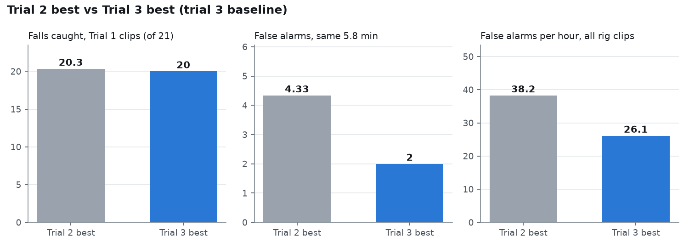
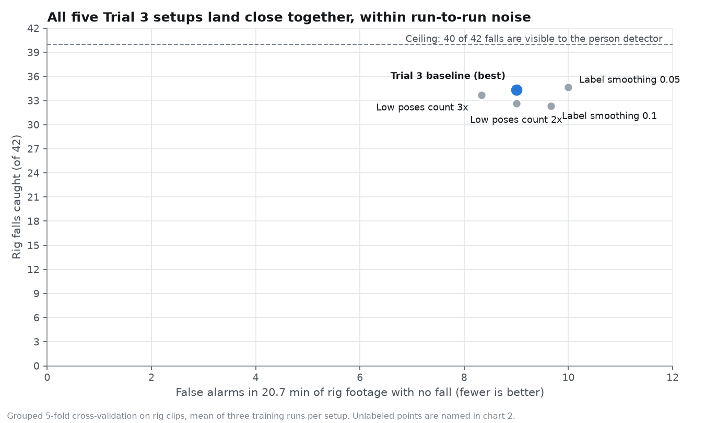
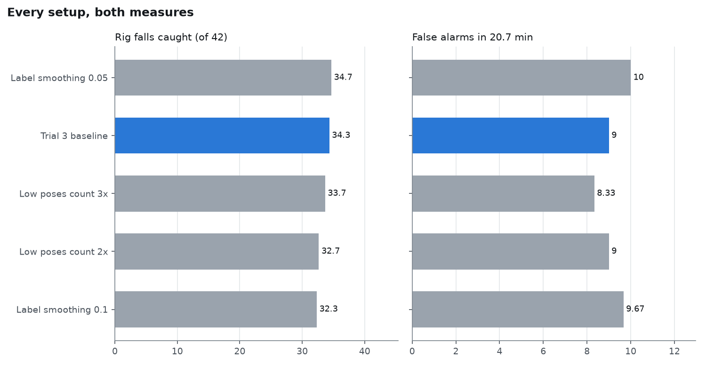
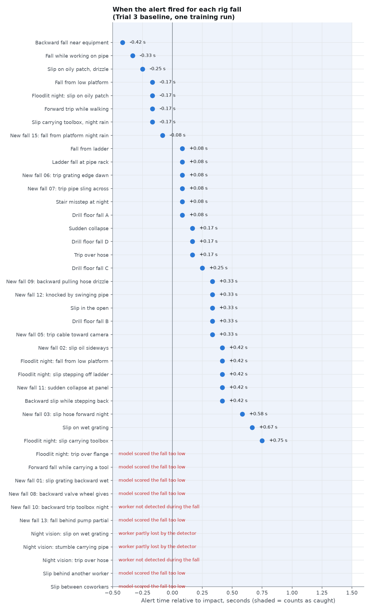
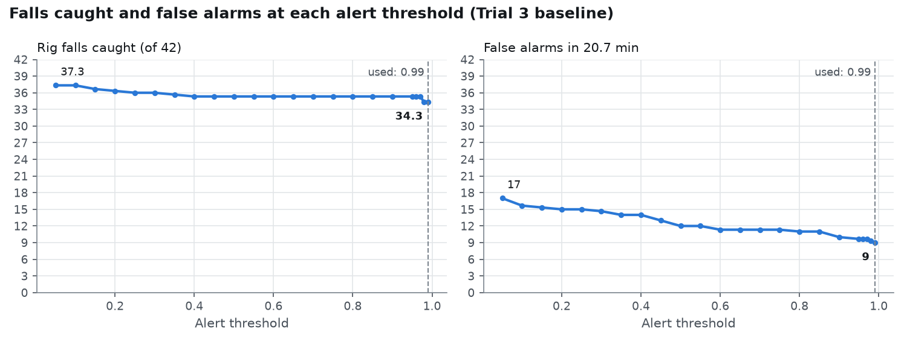
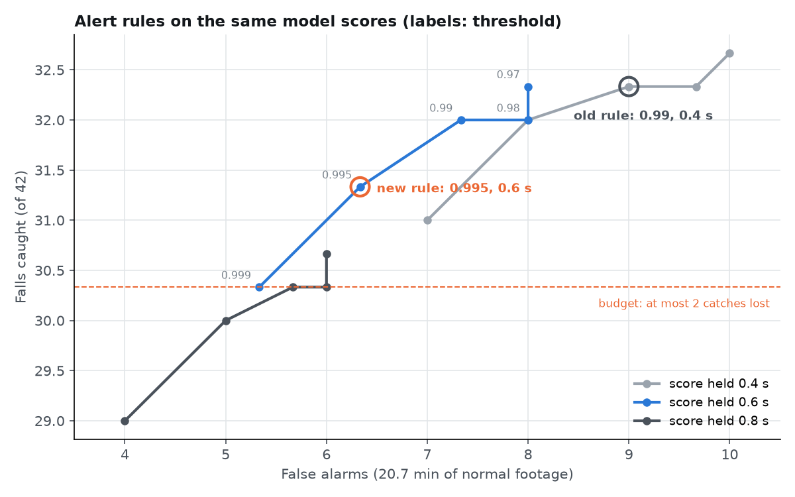
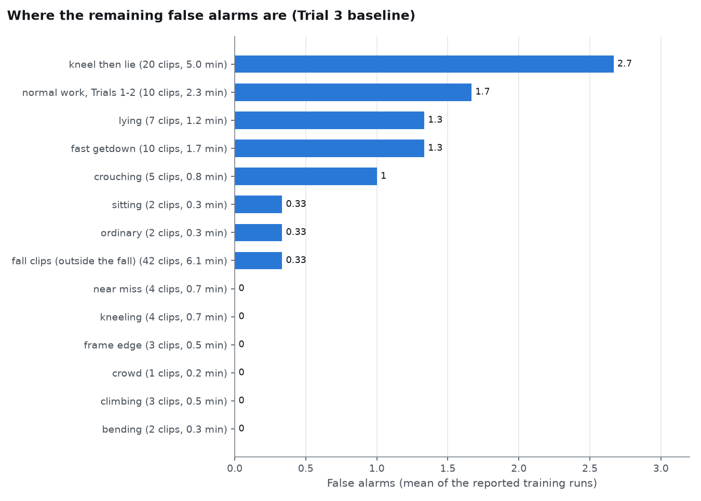

# Worker Fall Detection: Temporal Model Training, Trial 3

*Training runs of 19 November 2026. Figures are in `reports/2026-11-19_trial3/charts/`; example videos and stills are listed in section 4.4. Trial 2's write-up is `reports/2026-11-16_trial2/WRITEUP.md`.*

---

## 1. Summary

Trial 3 had one goal: keep Trial 2's high catch rate and cut false alarms. Trial 2's false alarms were all on workers crouching, kneeling, lying down or half out of the picture, and it had only 10 normal-work rig clips to learn from. Trial 3 adds 63 new normal-work clips aimed at exactly those situations, plus 13 new falls.

On the same 21 rig falls and 5.8 minutes of footage Trial 1 and 2 were scored on, the Trial 3 baseline (Trial 2's best setup, trained on the new data):

- **caught 20.0 of 21 falls**, against 20.3 in Trial 2, and
- **raised 2.0 false alarms**, down from 4.3. **False alarms more than halved, with the same model and settings. The only change is the data.**

On all 115 rig clips, including the new and harder ones, it caught **34.3 of 42 falls (82%)** with **9.0 false alarms in 20.7 minutes, or 26 per hour**, down from 38 per hour in Trial 2.

*Figure 6. Trial 2's best setup against Trial 3's baseline. Left and middle: the same Trial 1 clips. Right: false alarms per hour on all rig clips of each trial.*

| | Trial 2 best | **Trial 3 baseline** |
| --- | --- | --- |
| Falls caught, Trial 1's 21 rig falls | 20.3 (97%) | **20.0 (95%)** |
| False alarms, same 5.8 min | 4.3 | **2.0** |
| Falls caught, all rig falls | 25 of 29 (86%) | **34.3 of 42 (82%)** |
| False alarms, all rig footage | 4.3 in 6.8 min | 9.0 in 20.7 min |
| **False alarms per hour** | 38 | **26** |
| Median alert time after impact | +0.17 s | +0.22 s |
| Normal-work rig clips | 10 | 73 |

The four training changes tested on top of the baseline (label smoothing and extra weight on low poses) made no difference that stands out from run-to-run noise (section 4.2). The new data did the work.

26 false alarms per hour is still far from the target of under one per hour of normal work. Section 4.7 explains what the remaining false alarms are. A stricter alert rule, chosen afterwards on saved model scores (section 4.6), cuts false alarms by about 30% for one lost catch: **threshold 0.995 with the score held above it for 0.6 s instead of 0.4 s.** The final model, `models/fall_gru_trial3.pt`, uses this rule.

---

## 2. What changed since Trial 2

### 2.1 New training data

| Source | Clips | With a fall | Without a fall | Used for |
| --- | --- | --- | --- | --- |
| Rig clips, Trial 1 set (AI-generated) | 31 | 21 | 10 | Training and testing |
| Rig clips, night (AI-generated) | 8 | 8 | 0 | Training and testing |
| **New rig clips (AI-generated, FLUX 3 Max)** | 56 | 13 | 43 | Training and testing |
| **New normal-work clips from Evan (AI-generated)** | 20 | 0 | 20 | Training and testing |
| Team gym falls (real) | 22 | 22 | 0 | Training only |
| CAUCAFall (public dataset) | 88 of 100 | 38 | 50 | Training only |

**The new rig clips** were generated with the same video model and prompt style as the Trial 1 clips, in six deck scenes (main deck, pump skid, pipe rack, wellhead bay, stairs and ladder, drill floor) and three conditions (day, wet, floodlit night). The 43 normal-work clips each show one action, recorded in the label sheet's new `action` column:

| Action | Clips | What it shows |
| --- | --- | --- |
| Fast get-down | 10 | Dropping quickly to a knee, ducking a load, jumping down from a platform |
| Lying | 7 | Lying under equipment, crawling under a low pipe, getting up from the deck |
| Crouching | 5 | Crouching at gauges, squatting to pick up tools |
| Kneeling | 4 | Kneeling at valves and flanges |
| Near miss | 4 | Slipping or tripping and catching themselves |
| Frame edge | 3 | Workers carrying loads half out of the picture |
| Climbing, sitting, bending, ordinary work, crowd | 10 | |

**Evan's 20 clips** all follow one pattern: workers walk up to equipment, kneel, and lie down under or beside it (`action: kneel_then_lie`). Each is 15 seconds long.

**Clips left out.** Every clip was watched before labeling. Ten were dropped: eight normal-work clips that the video model generated sped up (real-time speed matters, because the model and the fast-drop check use how fast the body moves), and two falls that happen behind coworkers, where the fall itself is never visible. The 12 slow CAUCAFall falls stay out of training, as in Trial 2.

### 2.2 Labels and grouping

Fall times (loss of balance to impact) and the faller's tracker ID were set frame by frame on YOLO26m pose sheets, then reviewed by the team. The new clips are grouped for testing by **scene and condition** (for example `t3_pump_skid_night`), and Evan's clips by number of workers in four groups. Clips that share a scene and condition are always tested together by a model that saw none of them. Grouping by scene alone was tried first, but six large groups split very unevenly across the five folds (one fold got 24 normal-work clips, another 2).

### 2.3 The four setups tested

Every setup starts from Trial 2's best (mirrored copies, fast-drop check 0.15, duplicate-box removal) and changes one thing:

| Setup | What changed |
| --- | --- |
| **Trial 3 baseline** | Nothing: Trial 2's best setup on the new data |
| Label smoothing 0.05 | Training targets of 2.5% and 97.5% instead of 0% and 100% |
| Label smoothing 0.1 | Targets of 5% and 95% (the Trial 2 setting) |
| Low poses count 2x | Kneeling, crouching and lying normal windows weighted 2x in training |
| Low poses count 3x | The same, weighted 3x |

---

## 3. How the models were tested

Testing works exactly as in Trials 1 and 2, so the results compare directly.

- **Grouped 5-fold cross-validation** on the 115 rig clips. Each clip is scored by a model that never saw it or anything in its group. Gym and CAUCAFall clips are only added to training.
- **Each setup was trained 3 times** with different random starting points and the results averaged, which is why counts end in .3 or .7.
- **Testing replays the full live system**: tracking, the 0.4 s alert rule, the fast-drop check and the 30 s cooldown.
- **A fall counts as caught** when an alert fires for the person who fell, between 0.5 s before the fall starts and 1.5 s after impact. **A false alarm** is any other alert, on anyone, in the 20.7 minutes of rig footage outside those fall moments.
- **New in Trial 3: false alarms by action.** The report breaks false alarms down by the `action` column, so it shows which kinds of normal work still fool the model.

---

## 4. Results

### 4.1 Overview

*Figure 1. Every Trial 3 setup, falls caught against false alarms. All five sit close together.*

*Figure 2. The same results as bars, with every setup named.*

### 4.2 The four training changes

| Setup | Falls caught (of 42) | False alarms (20.7 min) | Per hour | Honest (caught, false) | On Trial 1 clips (of 21, false) |
| --- | --- | --- | --- | --- | --- |
| **Trial 3 baseline** | **34.3** | 9.0 | 26 | **34.3, 10.3** | **20.0, 2.0** |
| Label smoothing 0.05 | 34.7 | 10.0 | 29 | 34.7, 10.0 | 20.3, 1.7 |
| Label smoothing 0.1 | 32.3 | 9.7 | 28 | 32.0, 11.0 | 18.3, 1.7 |
| Low poses count 2x | 32.7 | 9.0 | 26 | 34.0, 9.7 | 19.0, 1.3 |
| Low poses count 3x | 33.7 | **8.3** | **24** | 33.7, 9.0 | 19.7, 2.7 |

- **None of the changes clearly beats the baseline.** Across its three training runs, the baseline alone raised 8, 7 and 12 false alarms, so a difference of one false alarm between setups is within the noise.
- **Label smoothing 0.1 cost two falls** without cutting false alarms. In Trial 2 it cut false alarms by 60%, but there it had 10 normal-work clips to work with. With 73, the data already gives the model the push smoothing used to.
- **Low poses count 3x had the fewest false alarms** (8.3) for 0.7 fewer catches. It is the only change that may be worth keeping, but the evidence is weak.
- **The baseline is the Trial 3 setup**: the most catches with the fewest settings, and the best on the Trial 1 clips.

### 4.3 The best setup, fall by fall

Over the three reported training runs, **31 of the 42 falls were caught by every run, 5 by two runs and 6 by none**.

*Figure 4. For each rig fall, when the alert fired relative to impact, in the example run (section 4.4). The shaded band is the window in which an alert counts as caught.*

- **Caught by every run:** 18 of the 21 Trial 1 falls, 10 of the 13 new falls (falls from platforms, slips on oil, trips, a collapse at a control panel, a worker knocked by a swinging pipe) and three of the five floodlit night falls. Alerts fired between 0.42 s before and 0.75 s after impact, typically 0.2 s after.
- **Never caught (6):**
  - The **two night-vision falls** Trial 2 also missed, where the detector loses or never finds the worker, and the **floodlit trip over a flange**, where the score peaks during the fall but the alert comes 2.5 s late.
  - **New fall 10, backward over a toolbox at night.** The detector loses the worker as soon as he goes over, so the model gets almost nothing to see.
  - **New fall 01, a slip on wet grating.** The worker windmills his arms upright for a full second before going down, and the model scores the actual drop low. The fall times may be worth checking against the video.
  - **New fall 13, a head-first fall behind a pump.** The worker is half hidden behind the motor as he goes down.
- **Caught by some runs (5):** three Trial 1 falls among coworkers or in the open, and two night falls. These are the falls most sensitive to training noise.

### 4.4 Example videos

As in Trials 1 and 2, the baseline was trained once more and every rig clip rendered as its held-out model saw it: skeletons and boxes for every tracked worker, each worker's fall score, the labeled fall, and a timeline of scores under the picture. A green banner marks a correct alert and a red banner a false alarm.

**This example run did worse than the three reported runs**: it caught 31 of 42 falls with 9 false alarms, against 33 to 35 catches for the reported runs. It was meant to repeat seed 0 exactly (35 caught), but training turned out not to repeat exactly from run to run. So the example run is best read as a fourth training run. That it lands below the other three means the run-to-run spread is wider than three runs show, and is one more reason the final model should average several training runs (section 5).

All paths below are inside `reports/2026-11-19_trial3/`.

| Example | What it shows | Annotated result video | Still image |
| --- | --- | --- | --- |
| New fall 15: fall from platform, night rain | Caught 0.08 s before impact | `videos/caught/fall_t2_15_fall_from_platform_night_rain.mp4` | `stills/fall_t2_15_fall_from_platform_night_rain_05.75s.jpg` |
| New fall 12: knocked by swinging pipe | Caught 0.33 s after impact, among three workers | `videos/caught/fall_t2_12_knocked_by_swinging_pipe.mp4` | `stills/fall_t2_12_knocked_by_swinging_pipe_06.33s.jpg` |
| New fall 01: slip on wet grating | Missed: the drop scores only 0.27 after a long stagger | `videos/missed/fall_t2_01_slip_grating_backward_wet.mp4` | `stills/fall_t2_01_slip_grating_backward_wet_05.00s.jpg` |
| New fall 10: backward over toolbox, night | Not visible: the detector loses the worker as he falls | `videos/not_visible/fall_t2_10_backward_trip_toolbox_night.mp4` | `stills/fall_t2_10_backward_trip_toolbox_night_05.17s.jpg` |
| Floodlit night: trip over flange | Missed: the alert comes at 7.0 s, 2.5 s after impact | `videos/missed/miller_night_fall_07_oh_trip_over_flange.mp4` | `stills/miller_night_fall_07_oh_trip_over_flange_07.00s.jpg` |
| New normal work 37: jump down, squat landing | False alarm on a worker landing in a deep squat | `videos/normal_work/normal_t2_37_jump_down_squat_landing.mp4` | `stills/normal_t2_37_jump_down_squat_landing_04.17s.jpg` |
| New normal work 30: crouch-walk under low pipe | False alarm on a worker ducking under a pipe | `videos/normal_work/normal_t2_30_crouch_walk_under_low_pipe.mp4` | `stills/normal_t2_30_crouch_walk_under_low_pipe_03.33s.jpg` |
| Evan normal work 1p_5 | False alarm as a worker lies down under equipment | `videos/normal_work/normal_work_1p_5.mp4` | `stills/normal_work_1p_5_10.08s.jpg` |
| New normal work 33: fast drop to knee | No alarm: a half-second drop to one knee, scored 0.68 at most | `videos/normal_work/normal_t2_33_fast_drop_to_knee.mp4` | |
| New normal work 51: carrying hose at frame edge | No alarm: the case behind a Trial 2 false alarm | `videos/normal_work/normal_t2_51_carry_hose_bottom_edge.mp4` | |

All 115 annotated videos are in `videos/`, sorted into `caught/` (31), `missed/` (9), `not_visible/` (2) and `normal_work/` (73). Still images at every alert and every missed impact are in `stills/`. The per-clip results behind the videos are in `data/examples.csv`, and the full report of the baseline run is `data/best_run_report.md`.

### 4.5 The alert threshold

*Figure 3. Baseline: falls caught and false alarms at each alert threshold.*

Every setup picked 0.99, the highest threshold the runs tested. Catches hold almost flat from 0.4 to 0.97 (35.3) and drop by one at 0.98 to 0.99, while false alarms keep falling all the way to 0.99 (from 17 at 0.05 to 9.0). Since false alarms were still falling at the top of the range, 0.995 and 0.999 were tested afterwards, together with other alert rules (section 4.6).

The fast-drop check is no help as a second dial this time. At 0.20 body lengths, false alarms stay at 9.0 and one fall is lost. At 0.25, false alarms fall to 5.0 but about six falls are lost (34.3 to 28.7), which is too many.

### 4.6 Choosing the alert rule

The model gives each person a fall score every frame. The **alert rule** turns those scores into alerts, and it can be changed without retraining. The baseline was trained once more with every test model's per-frame scores saved (run `t3-thr`), and three dials were tried on those scores, each alone and in every combination:

- **Threshold**: the score a person must stay above (0.97 to 0.999).
- **Time above it**: how long the score must stay above the threshold before an alert (0.4 s until now, 0.6 s and 0.8 s).
- **Stays-down check** (new): hold each alert 1, 1.5 or 2 s and drop it if the worker is back on their feet.

The team agreed beforehand to give up at most two of the 42 catches for a large cut in false alarms.

*Figure 7. Falls caught against false alarms for each threshold and time above it (no stays-down check), mean of three runs. The dashed line is the agreed budget of two lost catches.*

| Alert rule | Caught (of 42) | False alarms | Per hour | Alert time after impact | Honest (caught, false alarms) |
| --- | --- | --- | --- | --- | --- |
| Old: 0.99, held 0.4 s | 32.3 | 9.0 | 26 | +0.17 s | 31.0, 7.3 |
| Threshold 0.995 only | 32.0 | 8.0 | 23 | +0.19 s | |
| Threshold 0.999 only | 31.0 | 7.0 | 20 | +0.24 s | |
| Held 0.6 s only | 32.0 | 7.3 | 21 | +0.36 s | |
| Held 0.8 s only | 30.3 | 5.7 | 16 | +0.61 s | 29.3, 4.7 |
| Stays-down check, 1 to 2 s | 32.3 | 9.0 | 27 to 28 | +1.1 to +2.1 s | |
| **New: 0.995, held 0.6 s** | **31.3** | **6.3** | **18** | **+0.36 s** | **30.3, 5.7** |

The **Honest** column keeps the row's time above the threshold but picks the threshold for each fold from the other folds only, so it depends on the time above it, not on the threshold shown. This run's old-rule result (32.3 caught) is two below the reported baseline (34.3) although the setup is the same; this is the run-to-run spread described in section 4.8. The table compares rules on the same scores, so that spread does not affect the comparison.

- **Holding the score longer works best.** Real falls keep the score high for a long time; many false alarms are short spikes. Going from 0.4 s to 0.6 s removes almost two false alarms for a third of a catch.
- **Raising the threshold helps a little more on top.** On its own, 0.999 costs more catches than it saves false alarms.
- **The stays-down check removed nothing.** It works as designed, but the false alarms that remain are workers lying, kneeling or crouching on purpose, who really do stay down afterwards, so to the check they look like real falls. The fast get-downs in the test clips also stayed down for longer than 2 s. It would only delay every alert by 1 to 2 s, so it is not used.
- **The new rule: threshold 0.995, score held 0.6 s.** It loses one catch (32.3 to 31.3) and cuts false alarms from 9.0 to 6.3 (26 to 18 per hour), with alerts 0.2 s later. Holding 0.8 s cuts a little further but uses up the whole two-catch budget. The honest estimate, with the threshold picked without the tested clips, agrees: 30.3 caught and 5.7 false alarms.

Full tables are in `runs/2026-11-19_t3-thr/gate_sweep.md`.

### 4.7 What caused the good and the bad results

*Figure 5. Baseline: false alarms by what the normal-work clip shows (mean of the three reported runs).*

**Why false alarms dropped**

- **The model now sees what deliberate low work looks like.** The actions behind Trial 2's false alarms are covered many times over. Frame-edge carrying, kneeling, near misses, bending and climbing all went to **zero** false alarms, and the worker carrying a hose half out of the frame, a Trial 2 false alarm, is no longer one.
- **The old clips improved most:** 4.3 to 2.0 false alarms on the Trial 1 set. The new clips are harder (made to look like falls), and they raise 7.0 false alarms in 13.9 minutes on their own.

**Why false alarms remain**

- **Lying down on purpose is still the main cause.** Evan's kneel-then-lie clips (2.7 false alarms over 20 clips) and the lying-under-equipment clips (1.3) make up close to half of all false alarms. A worker who lowers themselves onto the deck ends up exactly where a fallen worker does.
- **Crouching and kneeling at equipment** account for most of the rest: the Trial 1 normal-work clips (1.7, the same crouched and kneeling workers behind Trial 2's false alarms, now fewer) and the new crouching clips (1.0).
- **Fast drops**: a jump down from a platform, a fast drop to a knee, ducking under a pipe, crawling. These fool the model briefly. A check that the worker gets back up was tested (section 4.6) but removed none of them, because these workers stay low for more than 2 s.
- **The remaining false alarms are confident ones.** As in Trial 2, the model scores them at 0.99 or more, so lowering sensitivity alone costs catches.

**Why falls are still missed**

- **The detector, as before.** Three of the six falls that no run caught are falls the person detector loses (two night-vision clips and the toolbox fall at night).
- **Unusual falls**: a long stagger before the drop, a fall half hidden behind a pump, a trip to the knees. There are few examples like these in training.

### 4.8 How much to trust these numbers

**No model was scored on a clip it trained on, or on anything from the same scene and condition.** The numbers are still somewhat optimistic, for the same reasons as in Trial 2, plus two new ones:

1. **Five setups were tried and the best reported.** The baseline was fixed before any results, so its lead does not come from choosing it after the fact, but the threshold of 0.99 was picked on the same clips it is scored on. The **Honest** column picks it without them: 34.3 caught and 10.3 false alarms, close to the headline.
2. **Similar prompts across folds.** The new clips come from a small set of prompt templates, and Evan's 20 clips from one. A model tested on one of Evan's clips trained on 15 near-identical ones. This flatters the false-alarm count on those clips most.
3. **All rig test footage is AI-generated**, and the new clips come from the same video model as the old ones.
4. **Training does not repeat exactly.** The example run (31 caught) fell below the three reported runs (33 to 35). Differences of one or two catches or false alarms between setups are not meaningful.

The validation set the team is preparing, kept out of everything until the final model is chosen and scored once, gives the number to trust.

### 4.9 Limits of this trial

- **The rig footage is still AI-generated.** Results on real rig cameras may differ, in either direction.
- **20.7 minutes of normal footage** is three times Trial 2's, but one false alarm still counts as about 3 per hour, and the footage is packed with hard cases. A real shift, mostly walking and standing work, would likely see fewer false alarms per hour than this test does.
- **The night-vision problem is unchanged.** No new night-vision clips were added; the detector still loses workers in infrared footage.
- **The alert rule was chosen on the same clips it is scored on.** The honest estimate in section 4.6 corrects for the threshold, but the time above it was also picked here. The validation set will check both.

---

## 5. Next steps

In priority order:

1. **Done: the alert rule** (section 4.6): threshold 0.995, score held 0.6 s (7 frames at 12 fps), no stays-down check.
2. **Done: the final model.** It was trained on all clips with the baseline setup for 9 epochs, the median best epoch of the 15 test models, and saved as `models/fall_gru_trial3.pt`. The file carries its own alert rule (threshold, time above it, fast-drop check) and frame rate; the live system now reads the time above the threshold from the file too. The live dashboard loads it with `FALL_CLASSIFIER_PATH=models/fall_gru_trial3.pt` in `.env`.
3. **Consider averaging several models.** The three training runs disagree on which clips get false alarms (8, 7 and 12), and one-off false alarms from one model tend to cancel out when several are averaged. The model is small enough to run three side by side live.
4. **Score once on the validation set**, with the final model and alert rule fixed beforehand. This is the number for the paper.
5. **Night-vision detection** (unchanged from Trial 2): fine-tune the person detector on infrared footage, or test a larger detector on the GPU.
6. **Real footage**: staged falls onto mats and long stretches of normal work on a real rig camera, to measure false alarms per hour on footage that is not AI-generated.

---

*CAUCAFall: J. C. Eraso, E. Muñoz, M. Muñoz and J. Pinto, Universidad del Cauca, doi:10.17632/7w7fccy7ky.4, licensed CC BY 4.0. Fall times were re-labeled and poses extracted by the project team.*
