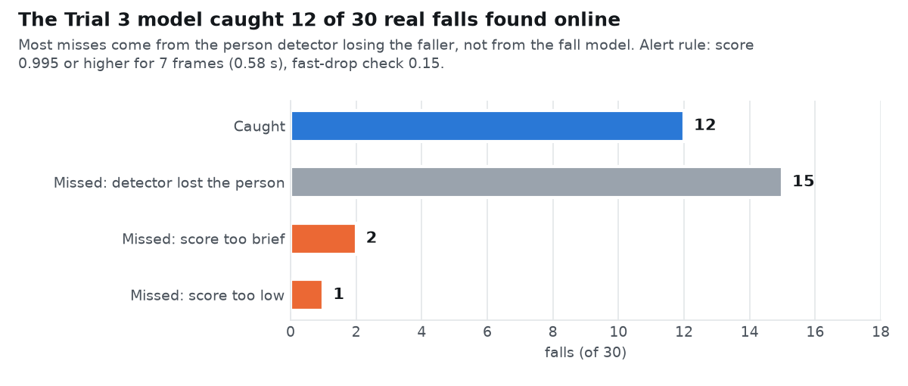
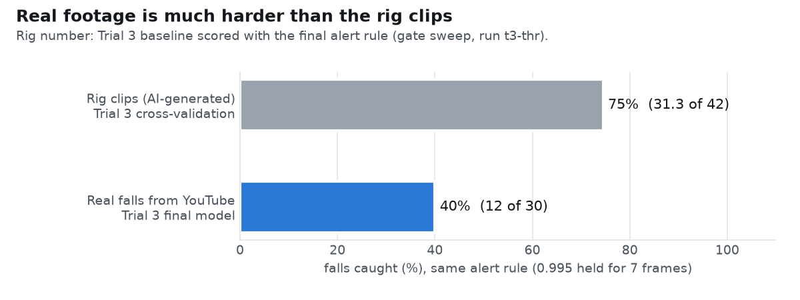
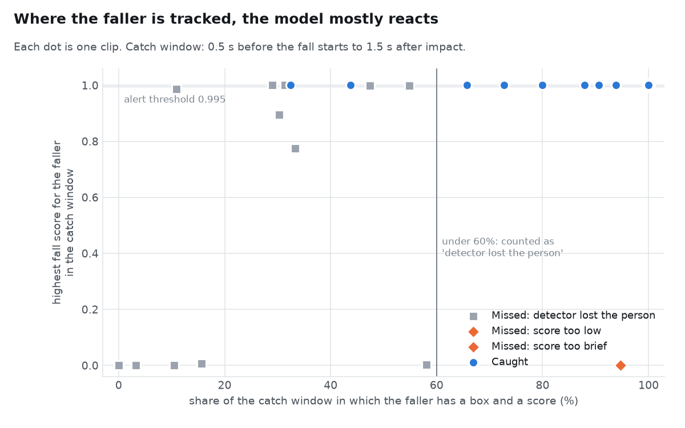
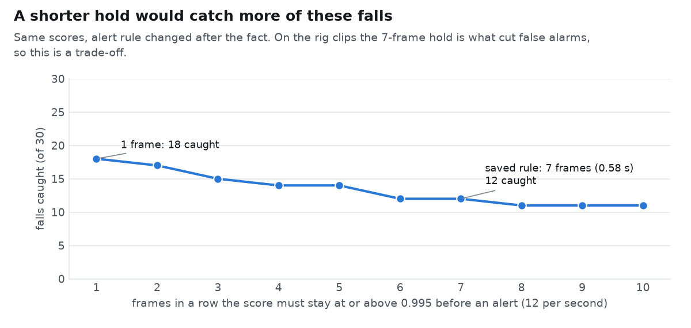
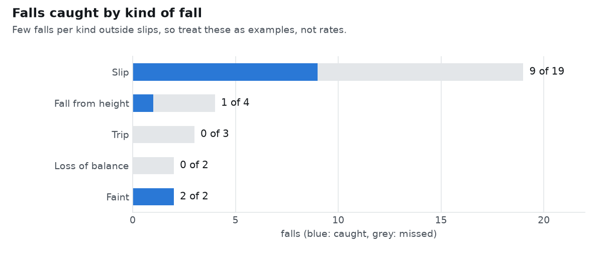
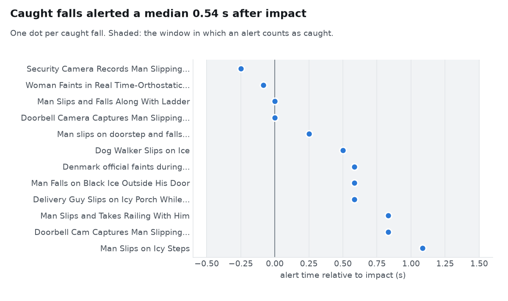

# Worker Fall Detection: The Trial 3 Model on Real Falls from YouTube

*Scored 23 November 2026. Charts are in `charts/`, annotated videos in `videos/`, key frames in `stills/`, per-clip numbers in `data/per_clip.csv`. This is the first half of Trial 4; the Trial 4 training run (with these clips in training and test) comes next.*

---

## 1. Summary

Our sponsor asked how the model does on real falls, not the AI-generated rig clips it was built on. We collected 41 videos of real falls posted on YouTube (security, doorbell and phone cameras), kept the 30 that are usable, and ran them through the **final Trial 3 model (`models/fall_gru_trial3.pt`), which has never seen any of them**, with its normal alert rule (score 0.995 or higher held for 7 frames, 0.58 s).

- **It caught 12 of the 30 falls (40%)**, alerting a median 0.54 s after impact, with **1 false alarm** in 13 minutes of footage.
- On the rig clips the same model and rule catch 75% (31.3 of 42). **Real footage is much harder.**
- **Most misses (15 of 18) are the person detector losing the faller**, not the fall model: the detector draws no box around the person for most of the fall, so the fall model never gets to judge it. Where the faller is tracked, the model usually reacts strongly.
- **3 misses are the fall model**: two falls scored at the alert level but for only 5 frames, short of the 7 needed, and one (a fall off a stepladder seen from directly above) never scored at all.



*Figure 1. What happened to each of the 30 falls.*



*Figure 6. The same model and alert rule on the rig clips and on the YouTube falls. The rig number comes from Trial 3's cross-validation scored with the final rule; the YouTube number is the final model itself.*

---

## 2. The clips

The team found 41 videos. Each was checked frame by frame; fall start (loss of balance) and fall end (body down) were set from frame sheets at 0.1 to 0.25 s spacing, and the faller's tracker ID was checked on the pose output. The label sheet is `data/labels/external_youtube.csv`; each video's link, title and uploader are in `data/labels/youtube_sources.csv`.

**Kept: 30 falls.** 19 slips (mostly icy steps and porches), 4 falls from height (a ladder sliding out, a stepladder, through a warehouse roof, into an open floor void), 3 trips, 2 losses of balance, 2 faints. Two are workplace falls: an office worker tripping over boxes, and a scaffolder falling through a roof.

**Dropped: 11.** Too small or dark to see the person (5), a staged fall (the news caption says he lay down on purpose), a fall-protection demo with what looks like a dummy, 6 frames per second, a phone recording of a monitor, a fall into a pool, and a clip where the fall starts in the first half second.

**How these differ from the rig clips.** These are mostly homes, porches and driveways, not an oil rig. Many are doorbell cameras with fisheye lenses, night infrared, or vertical phone video, and the faller is often half hidden by a railing or plant. They are all falls: there is no normal-work footage, so they measure **catches, not false alarms**.

---

## 3. How they were scored

Exactly as in the trial reports. Poses come from the same pipeline as training (YOLO26m person detector + RTMPose-t, 12 frames per second). Each clip is replayed as live detection would run it, and **a fall counts as caught if the faller gets an alert from 0.5 s before the fall starts to 1.5 s after impact**. Any other alert is a false alarm.

Every miss is put in one of three groups, from the faller's scores inside that catch window:

| Group | Meaning |
|---|---|
| Detector lost the person | the faller has a box and a score in under 60% of the catch window |
| Score too brief | the faller reached 0.995, but for fewer than 7 frames in a row |
| Score too low | the faller was tracked but never reached 0.995 |

---

## 4. Results

### 4.1 Tracking decides most outcomes



*Figure 2. Each clip by how much of the catch window the faller is tracked (left to right) and the highest score the model gave them (bottom to top).*

- **Every clip where the faller is tracked for 60% or more of the catch window was caught, except three.** The model recognises these real falls when it can see them.
- **Five "detector lost the person" clips still reached a score of 0.98 or more**, but the gaps in tracking broke the 7-frame hold. Better tracking would likely catch these.
- **Eight clips are almost never tracked during the fall** (0 to 16% of the catch window). Among them: a night doorbell clip, a workplace trip with boxes flying, a lobby and a courtyard where the person is small, a man hidden behind a hanging plant, a woman whose landing is hidden behind parked bins, and the roof fall, where the worker drops into view mid-air.

### 4.2 The alert rule



*Figure 3. Falls caught if the score only had to stay above 0.995 for fewer frames, on the same scores.*

With a 1-frame hold the model would catch 18 of 30. On the rig clips, the 7-frame hold is what cut false alarms (Trial 3, section 4.6), and these clips cannot tell us how many false alarms a shorter hold would add, because they contain no normal work. So this is a trade-off to test on the validation set, not a free gain.

### 4.3 By kind of fall, and alert timing



*Figure 4. Falls caught by kind of fall. Outside slips there are only 2 to 4 of each, so these are examples, not rates.*

- **Both faints were caught**, although none of the training falls is labeled as a faint.
- **Trips and losses of balance: none caught (0 of 5)**, mostly tracking: in four of them the faller is tracked in a third of the catch window or less. The fifth scored at the alert level for 5 frames, 2 short of the hold.
- **Falls from height: 1 of 4.** The roof fall and the floor void are tracking failures (the worker is only seen mid-air, or drops out of view). The stepladder fall, filmed from directly above, is the one clip the model did not react to at all: the camera only sees head and shoulders before the fall.



*Figure 5. When each caught fall's alert fired, relative to impact.*

### 4.4 False alarms

One, in the press conference faint: 7 seconds after the correct alert, on a man who drops to his knees beside her to help (`videos/caught/yt_KYtkbH8oKT4.mp4` at 11.3 s). It is the same kind of false alarm as on the rig: a person deliberately getting low. With no normal-work clips, this says little about false alarms in general.

---

## 5. Every clip

Videos show skeletons and boxes for every tracked person, each person's fall score, the labeled fall (grey band on the timeline), and alerts (green banner: correct; red: false alarm). Paths are relative to this folder.

| Outcome | Clip | Kind | Alert after impact | Faller tracked | Highest score | Video |
|---|---|---|---|---|---|---|
| Caught | Man Slips and Falls Along With Ladder | from height | +0.00 s | 73% | 1.00 | `videos/caught/yt_BsiEFbqZ2Ts.mp4` |
| Caught | Delivery Guy Slips on Icy Porch | slip | +0.58 s | 80% | 1.00 | `videos/caught/yt_KKH4vwZ6H3M.mp4` |
| Caught | Denmark official faints during conference | faint | +0.58 s | 88% | 1.00 | `videos/caught/yt_KYtkbH8oKT4.mp4` |
| Caught | Dog Walker Slips on Ice | slip | +0.50 s | 91% | 1.00 | `videos/caught/yt_asrf4fo3Nhk.mp4` |
| Caught | Man Falls on Black Ice Outside His Door | slip | +0.58 s | 94% | 1.00 | `videos/caught/yt_at0cr31cjLY.mp4` |
| Caught | Man Slips and Takes Railing With Him | slip | +0.83 s | 100% | 1.00 | `videos/caught/yt_dEIH79bt-pc.mp4` |
| Caught | Man slips on doorstep (Sichuan) | slip | +0.25 s | 66% | 1.00 | `videos/caught/yt_mLj689_axHo.mp4` |
| Caught | Man Slipping Down Outdoor Stairs | slip | -0.25 s | 100% | 1.00 | `videos/caught/yt_mmbLK9JS4sw.mp4` |
| Caught | Man Slipping and Falling Down Steps | slip | +0.00 s | 91% | 1.00 | `videos/caught/yt_odwhsAr2Lc4.mp4` |
| Caught | Woman Faints in Real Time | faint | -0.08 s | 100% | 1.00 | `videos/caught/yt_ucGKsoQu2yk.mp4` |
| Caught | Man Slipping Down Icy Steps (doorbell) | slip | +0.83 s | 44% | 1.00 | `videos/caught/yt_vWDzcY0bDIM.mp4` |
| Caught | Man Slips on Icy Steps | slip | +1.08 s | 32% | 1.00 | `videos/caught/yt_yTN2G5QfhFE.mp4` |
| Score too brief | Man Slips On Stairs (CCTV) | slip | | 100% | 1.00 (5 frames) | `videos/missed_score_too_brief/yt_SiN1voQ1WNI.mp4` |
| Score too brief | Woman trips in front of doorbell camera | trip | | 100% | 1.00 (5 frames) | `videos/missed_score_too_brief/yt_tXrBh6eTV8.mp4` |
| Score too low | Guy Falls Off Step Ladder | from height | | 95% | 0.00 | `videos/missed_score_too_low/yt_NQPNeCWElYU.mp4` |
| Detector lost | Doorbell: Friend's Slip and Fall (night) | slip | | 3% | 0.00 | `videos/missed_detector_lost_person/yt_2X7wXA1XzqU.mp4` |
| Detector lost | Workplace Fall on Security Camera | trip | | 16% | 0.01 | `videos/missed_detector_lost_person/yt_4nQuQnaZjy8.mp4` |
| Detector lost | Slip and fall (lobby security camera) | slip | | 0% | none | `videos/missed_detector_lost_person/yt_B7PqBfWOEl8.mp4` |
| Detector lost | Slipping Into 2026 Like | slip | | 58% | 0.00 | `videos/missed_detector_lost_person/yt_L85-wRuwiQU.mp4` |
| Detector lost | Man falls on stairs carrying trash | loss of balance | | 11% | 0.00 | `videos/missed_detector_lost_person/yt_QBY1NCreRw.mp4` |
| Detector lost | Woman Slips and Falls Hard on Icy Porch | slip | | 29% | 1.00 | `videos/missed_detector_lost_person/yt_RB_agBkBpsk.mp4` |
| Detector lost | Man Twists Ankle and Falls | loss of balance | | 33% | 0.78 | `videos/missed_detector_lost_person/yt_TYHKysfS2VE.mp4` |
| Detector lost | Man falls over on CCTV (curb trip) | trip | | 11% | 0.99 | `videos/missed_detector_lost_person/yt_UFf0NMHk0Ec.mp4` |
| Detector lost | Worker falls through roof | from height | | 0% | none | `videos/missed_detector_lost_person/yt_aVM1U-RY5A8.mp4` |
| Detector lost | Woman Slips on an Icy Driveway | slip | | 0% | none | `videos/missed_detector_lost_person/yt_dC1prm3x788.mp4` |
| Detector lost | Slip and Spill Down the Stairs | slip | | 55% | 1.00 | `videos/missed_detector_lost_person/yt_fFbfT5Hh7ro.mp4` |
| Detector lost | Slips on wet floor running to garbage truck | slip | | 0% | none | `videos/missed_detector_lost_person/yt_iGnNWB6q-A.mp4` |
| Detector lost | Man Falls Through Floor at Construction Site | from height | | 47% | 1.00 | `videos/missed_detector_lost_person/yt_mrwT3kkhw-k.mp4` |
| Detector lost | Doorbell: Friend's Fall (night) | slip | | 30% | 0.90 | `videos/missed_detector_lost_person/yt_smxB_Vetgbo.mp4` |
| Detector lost | Woman Slips Down Icy Porch Steps (night) | slip | | 31% | 1.00 | `videos/missed_detector_lost_person/yt_zZPht5TJZPE.mp4` |

"Faller tracked" is the share of the catch window in which the faller has a box and a score. "Highest score" is the faller's highest score inside the catch window.

---

## 6. How far to trust this

- **The model never saw these clips**, so this is a fair test of the model as it stands. Fall times were set by one reviewer from frame sheets and are worth a spot check (the notes column of the label sheet flags the judgment calls).
- **30 falls is a small sample.** One clip moves the catch rate by 3 points.
- **Catches only.** There is no normal footage, so nothing here says how often the model would raise false alarms on real cameras.
- **Different setting.** Homes and porches, not rigs; many doorbell and night cameras. The detector problems are probably worse here than on a rig camera mounted for the job, but that is untested.

---

## 7. What this suggests

1. **The person detector is the bottleneck on real footage**, as it was in Trial 1 on the rig clips. Ideas worth testing: a lower detection confidence during fast motion, keeping a lost track's box alive longer through the fall, or a larger detector input size.
2. **The 7-frame hold costs 6 catches here** (18 with a 1-frame hold). Worth re-testing on the validation set, which has normal work to count false alarms against.
3. **Trial 4 next:** train with these 30 clips in the cross-validation folds (each clip tested only by a model that never saw it) to see whether real falls in training help the model on real footage, and whether they change the rig results. Training cannot fix the 15 tracking failures, so expect at most a few more catches from the "score too brief / too low" group.

---

## 8. Files

- `videos/caught/`, `videos/missed_*/`: one annotated MP4 per clip. **Not in git**: they show the uploaders' footage, which has no license for redistribution (see `DATA_SOURCES.md`). Rebuild them with the command below.
- `stills/`: the alert frame of each caught fall and the impact frame of each miss. Not in git, for the same reason.
- `charts/`: Figures 1 to 6.
- `data/per_clip.csv`: every clip's outcome, timing, tracking and link; `data/summary.json`: totals.
- `../data/trial3_model_on_youtube.json`: the same scores from `scripts/score_checkpoint.py`.

Rebuild everything (about 15 minutes; needs the videos from `scripts/download_youtube.py` and the poses in `data/output/youtube/`):

```
uv run --no-sync scripts/build_youtube_report.py
```
