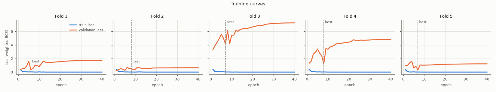
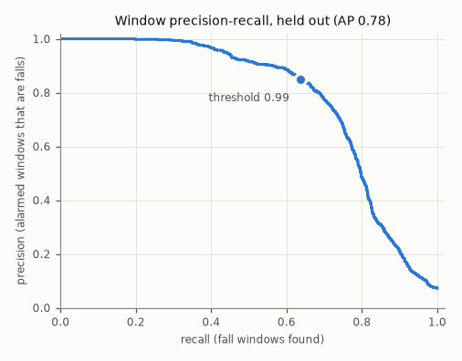
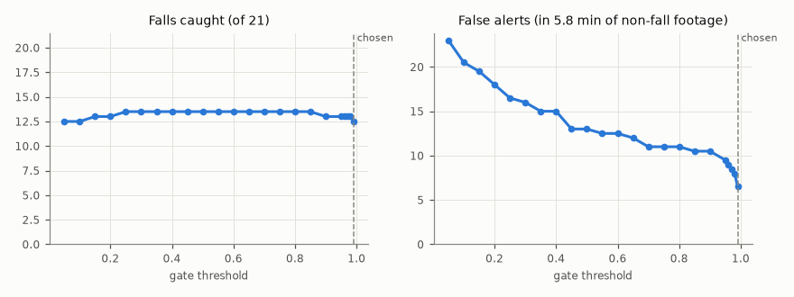
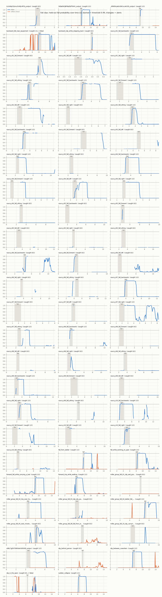
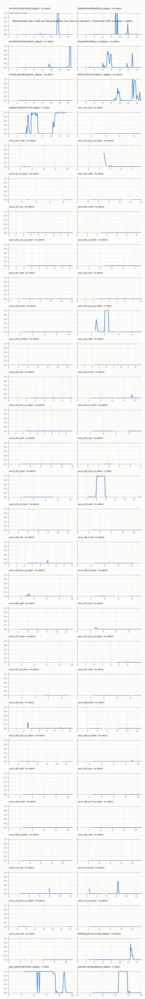

# Temporal model run: cauca-in-folds

2026-11-05T20:20:31 · commit `897c565+changes` · manifest.json: 131 clips, 71 falls

## Headline

At the chosen gate threshold **0.99** (mean of 2 seeds), held out by 5-fold grouped cross-validation (every clip tested once, by a model that never saw its scene):

- **Falls caught: 12.5 of 21** (60%), alert within 1.5 s of impact
- **False alerts: 6.5** in 5.8 min of non-fall footage (5 on the normal-work clips)
- Median alert time: +0.25 s relative to impact
- Late alerts (faller, after the catch window): 0
- Window-level: average precision 0.78, precision 0.85 / recall 0.64 at this threshold

> One false alert in 5.8 min is 10/hour, so this data cannot show the 1/hour target directly; the threshold is chosen for the fewest false alerts seen, then the most falls caught.

## Data and settings

- 131 clips (71 with a fall), 38 scene groups, 12 fps, windows of 30 frames (2.5 s), stride 1
- Model: GRU, hidden 64, dropout 0.1, up to 40 epochs (best by validation), learning rate 0.002
- Ambiguous windows (0-50% of a fall) left out: yes
- Augmented copies per training clip: 0; synthetic clips added: 0
- Gate: debounce 5 frames (0.42 s), cooldown 30 s
- Seeds: 0, 1
- Tested clips by source: caucafall 100 (50 falls), rig 31 (21 falls)
- External clips added to every training set (never tested): none

## Threshold trade-off

| Threshold | Falls caught | False alerts | Per hour | Normal-clip false | Median alert time | Window precision | Window recall |
|---:|---:|---:|---:|---:|---:|---:|---:|
| 0.05 | 12.5/21 | 23 | 238 | 16.5 | -0.02 s | 0.56 | 0.78 |
| 0.10 | 12.5/21 | 20.5 | 212 | 14 | +0.04 s | 0.59 | 0.77 |
| 0.15 | 13/21 | 19.5 | 202 | 14 | +0.04 s | 0.62 | 0.77 |
| 0.20 | 13/21 | 18 | 187 | 14 | +0.04 s | 0.63 | 0.76 |
| 0.25 | 13.5/21 | 16.5 | 171 | 13.5 | +0.04 s | 0.65 | 0.76 |
| 0.30 | 13.5/21 | 16 | 166 | 13 | +0.04 s | 0.66 | 0.75 |
| 0.35 | 13.5/21 | 15 | 155 | 12 | +0.04 s | 0.67 | 0.75 |
| 0.40 | 13.5/21 | 15 | 155 | 12 | +0.06 s | 0.68 | 0.75 |
| 0.45 | 13.5/21 | 13 | 135 | 10.5 | +0.06 s | 0.69 | 0.75 |
| 0.50 | 13.5/21 | 13 | 135 | 10.5 | +0.08 s | 0.70 | 0.74 |
| 0.55 | 13.5/21 | 12.5 | 130 | 10 | +0.08 s | 0.71 | 0.74 |
| 0.60 | 13.5/21 | 12.5 | 130 | 10 | +0.08 s | 0.72 | 0.73 |
| 0.65 | 13.5/21 | 12 | 124 | 9.5 | +0.08 s | 0.72 | 0.73 |
| 0.70 | 13.5/21 | 11 | 114 | 9.5 | +0.10 s | 0.73 | 0.73 |
| 0.75 | 13.5/21 | 11 | 114 | 9.5 | +0.10 s | 0.74 | 0.72 |
| 0.80 | 13.5/21 | 11 | 114 | 9.5 | +0.10 s | 0.75 | 0.72 |
| 0.85 | 13.5/21 | 10.5 | 109 | 9 | +0.15 s | 0.76 | 0.71 |
| 0.90 | 13/21 | 10.5 | 109 | 9 | +0.15 s | 0.77 | 0.71 |
| 0.95 | 13/21 | 9.5 | 98 | 8 | +0.17 s | 0.79 | 0.69 |
| 0.96 | 13/21 | 9 | 93 | 7.5 | +0.17 s | 0.80 | 0.69 |
| 0.97 | 13/21 | 8.5 | 88 | 7 | +0.19 s | 0.81 | 0.68 |
| 0.98 | 13/21 | 8 | 83 | 6.5 | +0.19 s | 0.82 | 0.66 |
| 0.99 **(chosen)** | 12.5/21 | 6.5 | 67 | 5 | +0.25 s | 0.85 | 0.64 |

## By source (at the chosen threshold)

The headline and threshold use the rig clips only.

| Source | Falls caught | False alerts | Non-fall minutes |
|---|---:|---:|---:|
| caucafall | 22.5/50 | 2 | 14.2 |
| rig | 12.5/21 | 6.5 | 5.8 |

## Folds

| Seed | Fold | Test clips | Train windows (falls) | Test windows (falls) | Best epoch | Avg precision | F1 @0.5 |
|---:|---:|---:|---:|---:|---:|---:|---:|
| 0 | 1 | 29 | 11200 (690) | 2497 (298) | 6 | 0.80 | 0.74 |
| 0 | 2 | 17 | 10943 (739) | 2118 (164) | 8 | 0.74 | 0.60 |
| 0 | 3 | 35 | 9233 (588) | 3376 (190) | 7 | 0.81 | 0.67 |
| 0 | 4 | 34 | 9176 (649) | 3458 (157) | 8 | 0.86 | 0.77 |
| 0 | 5 | 16 | 10592 (755) | 3026 (234) | 7 | 0.78 | 0.78 |
| 1 | 1 | 29 | 10816 (665) | 2497 (298) | 6 | 0.81 | 0.78 |
| 1 | 2 | 17 | 11052 (790) | 2118 (164) | 17 | 0.84 | 0.69 |
| 1 | 3 | 35 | 9227 (684) | 3376 (190) | 4 | 0.88 | 0.73 |
| 1 | 4 | 34 | 8758 (662) | 3458 (157) | 11 | 0.85 | 0.68 |
| 1 | 5 | 16 | 10213 (690) | 3026 (234) | 12 | 0.74 | 0.76 |

## Per clip (at the chosen threshold)

| Clip | Fold | Fall (s) | Fall windows | Caught | Alert time | False alerts | Peak p faller | Peak p others |
|---|---:|---|---:|---:|---:|---:|---:|---:|
| 1xiFn4bLdT-6Alz7z0XDz_alligator | 2 | - | - | - | - | 1 | - | 1.00 |
| 29jB-BibMmaRAZBqZtNnU_alligator | 5 | - | - | - | - | 0 | - | 1.00 |
| 4CJH5B2NtzP8VwFzxMwO5_alligator | 3 | - | - | - | - | 0 | - | 0.99 |
| EIlywKhfkRHTAlBqul_mf_alligator | 4 | - | - | - | - | 1 | - | 0.88 |
| ILLOvByCSJmu2U4QL4R7q_output | 1 | 3.00-3.50 | 0 | 0/2 | - | 0 | 0.32 | - |
| LXCUWr1Hjb3MEZVgdYPIh_alligator | 4 | - | - | - | - | 0 | - | 0.00 |
| MIPR_SGTQICev4mFBDU2c_alligator | 5 | - | - | - | - | 1 | - | 1.00 |
| UyNpEpYTGgJkfrlSRc7Kd_alligator | 2 | - | - | - | - | 2 | - | 1.00 |
| YdQeOIiCjBFNpPjdTE641_output | 1 | 6.75-7.33 | 28 | 2/2 | +0.46 | 0 | 1.00 | 0.00 |
| _4RXOScjeGcGW1uLah2Cb_output | 1 | 8.83-9.50 | 8 | 2/2 | +0.21 | 0 | 1.00 | 0.00 |
| backward_fall_near_equipment | 4 | 9.75-10.75 | 30 | 2/2 | -0.42 | 2 | 1.00 | 1.00 |
| backward_slip_while_stepping_back | 2 | 10.00-10.67 | 3 | 0/2 | - | 0 | 0.91 | 0.17 |
| cauca_s01_fall_backwards | 1 | 2.42-3.00 | 29 | 2/2 | +0.00 | 0 | 1.00 | - |
| cauca_s01_fall_forward | 1 | 6.17-6.75 | 26 | 1/2 | +0.50 | 0 | 0.99 | - |
| cauca_s01_fall_left | 1 | 1.42-2.08 | 22 | 2/2 | +0.67 | 0 | 1.00 | - |
| cauca_s01_fall_right | 1 | 1.92-2.58 | 16 | 2/2 | +0.17 | 0 | 1.00 | - |
| cauca_s01_fall_sitting | 1 | 3.92-4.67 | 20 | 2/2 | +0.92 | 0 | 1.00 | - |
| cauca_s01_hop | 1 | - | - | - | - | 0 | - | 0.03 |
| cauca_s01_kneel | 1 | - | - | - | - | 0 | - | 0.07 |
| cauca_s01_pick_up_object | 1 | - | - | - | - | 0 | - | 0.33 |
| cauca_s01_sit_down | 1 | - | - | - | - | 0 | - | 0.00 |
| cauca_s01_walk | 1 | - | - | - | - | 0 | - | 0.00 |
| cauca_s02_fall_backwards | 1 | 2.67-3.33 | 26 | 2/2 | +0.08 | 0 | 1.00 | - |
| cauca_s02_fall_forward | 1 | 0.67-1.42 | 13 | 2/2 | +1.33 | 0 | 1.00 | - |
| cauca_s02_fall_left | 1 | 1.17-1.75 | 18 | 2/2 | +1.08 | 0 | 1.00 | - |
| cauca_s02_fall_right | 1 | 1.17-1.75 | 1 | 0/2 | - | 0 | 1.00 | - |
| cauca_s02_fall_sitting | 1 | 3.17-3.92 | 29 | 1/2 | +0.08 | 0 | 0.94 | - |
| cauca_s02_hop | 1 | - | - | - | - | 0 | - | 0.00 |
| cauca_s02_kneel | 1 | - | - | - | - | 0 | - | 0.00 |
| cauca_s02_pick_up_object | 1 | - | - | - | - | 0 | - | 0.00 |
| cauca_s02_sit_down | 1 | - | - | - | - | 0 | - | 0.00 |
| cauca_s02_walk | 1 | - | - | - | - | 0 | - | 0.00 |
| cauca_s03_fall_backwards | 2 | 2.75-3.33 | 18 | 2/2 | -0.08 | 0 | 1.00 | - |
| cauca_s03_fall_forward | 2 | 3.50-4.42 | 0 | 0/2 | - | 0 | 1.00 | - |
| cauca_s03_fall_left | 2 | 4.67-5.33 | 0 | 0/2 | - | 0 | 0.27 | - |
| cauca_s03_fall_right | 2 | 2.17-2.83 | 30 | 2/2 | -0.08 | 0 | 1.00 | - |
| cauca_s03_fall_sitting | 2 | 2.25-3.08 | 6 | 0/2 | - | 0 | 0.00 | - |
| cauca_s03_hop | 2 | - | - | - | - | 0 | - | 0.00 |
| cauca_s03_kneel | 2 | - | - | - | - | 0 | - | 0.05 |
| cauca_s03_pick_up_object | 2 | - | - | - | - | 1 | - | 0.58 |
| cauca_s03_sit_down | 2 | - | - | - | - | 0 | - | 0.00 |
| cauca_s03_walk | 2 | - | - | - | - | 0 | - | 0.00 |
| cauca_s04_fall_backwards | 5 | 3.00-3.67 | 28 | 2/2 | -0.08 | 0 | 1.00 | - |
| cauca_s04_fall_forward | 5 | 0.67-1.25 | 12 | 1/2 | +1.50 | 0 | 0.50 | - |
| cauca_s04_fall_left | 5 | 2.33-3.08 | 28 | 2/2 | +1.04 | 0 | 1.00 | - |
| cauca_s04_fall_right | 5 | 1.83-2.33 | 26 | 2/2 | +0.42 | 0 | 1.00 | - |
| cauca_s04_fall_sitting | 5 | 2.67-3.33 | 30 | 0/2 | - | 0 | 0.00 | - |
| cauca_s04_hop | 5 | - | - | - | - | 0 | - | 0.00 |
| cauca_s04_kneel | 5 | - | - | - | - | 0 | - | 0.08 |
| cauca_s04_pick_up_object | 5 | - | - | - | - | 0 | - | 0.01 |
| cauca_s04_sit_down | 5 | - | - | - | - | 0 | - | 0.00 |
| cauca_s04_walk | 5 | - | - | - | - | 0 | - | 0.00 |
| cauca_s05_fall_backwards | 3 | 1.50-2.42 | 0 | 0/2 | - | 0 | 0.23 | - |
| cauca_s05_fall_forward | 3 | 2.17-2.92 | 0 | 0/2 | - | 0 | 0.91 | - |
| cauca_s05_fall_left | 3 | 2.50-3.83 | 0 | 0/2 | - | 0 | 0.05 | - |
| cauca_s05_fall_right | 3 | 3.08-3.67 | 0 | 0/2 | - | 0 | 0.19 | - |
| cauca_s05_fall_sitting | 3 | 2.58-3.58 | 1 | 0/2 | - | 0 | 0.49 | - |
| cauca_s05_hop | 3 | - | - | - | - | 0 | - | 0.00 |
| cauca_s05_kneel | 3 | - | - | - | - | 0 | - | 0.01 |
| cauca_s05_pick_up_object | 3 | - | - | - | - | 2 | - | 1.00 |
| cauca_s05_sit_down | 3 | - | - | - | - | 0 | - | 0.01 |
| cauca_s05_walk | 3 | - | - | - | - | 0 | - | 0.01 |
| cauca_s06_fall_backwards | 4 | 4.08-4.67 | 8 | 0/2 | - | 0 | 1.00 | - |
| cauca_s06_fall_forward | 4 | 3.33-4.08 | 1 | 0/2 | - | 0 | 1.00 | - |
| cauca_s06_fall_left | 4 | 1.75-2.67 | 0 | 0/2 | - | 0 | 0.74 | - |
| cauca_s06_fall_right | 4 | 3.25-3.83 | 0 | 0/2 | - | 0 | 0.57 | - |
| cauca_s06_fall_sitting | 4 | 4.25-5.17 | 0 | 0/2 | - | 0 | 0.50 | - |
| cauca_s06_hop | 4 | - | - | - | - | 0 | - | 0.06 |
| cauca_s06_kneel | 4 | - | - | - | - | 0 | - | 0.00 |
| cauca_s06_pick_up_object | 4 | - | - | - | - | 1 | - | 0.56 |
| cauca_s06_sit_down | 4 | - | - | - | - | 0 | - | 0.01 |
| cauca_s06_walk | 4 | - | - | - | - | 0 | - | 0.00 |
| cauca_s07_fall_backwards | 3 | 3.58-4.42 | 30 | 2/2 | -0.21 | 0 | 1.00 | - |
| cauca_s07_fall_forward | 3 | 1.33-2.42 | 0 | 0/2 | - | 0 | 0.00 | - |
| cauca_s07_fall_left | 3 | 2.83-3.67 | 2 | 0/2 | - | 0 | 0.99 | - |
| cauca_s07_fall_right | 3 | 1.50-2.42 | 22 | 2/2 | +0.50 | 0 | 1.00 | - |
| cauca_s07_fall_sitting | 3 | 2.33-3.08 | 27 | 2/2 | +0.62 | 0 | 1.00 | - |
| cauca_s07_hop | 3 | - | - | - | - | 0 | - | 0.06 |
| cauca_s07_kneel | 3 | - | - | - | - | 0 | - | - |
| cauca_s07_pick_up_object | 3 | - | - | - | - | 0 | - | 0.00 |
| cauca_s07_sit_down | 3 | - | - | - | - | 0 | - | 0.00 |
| cauca_s07_walk | 3 | - | - | - | - | 0 | - | 0.00 |
| cauca_s08_fall_backwards | 4 | 2.42-3.08 | 10 | 2/2 | -0.08 | 0 | 1.00 | - |
| cauca_s08_fall_forward | 4 | 1.08-1.67 | 0 | 0/2 | - | 0 | 0.00 | - |
| cauca_s08_fall_left | 4 | 2.08-2.67 | 0 | 0/2 | - | 0 | 0.02 | - |
| cauca_s08_fall_right | 4 | 2.08-2.92 | 26 | 0/2 | - | 0 | 0.94 | - |
| cauca_s08_fall_sitting | 4 | 3.17-4.00 | 0 | 0/2 | - | 0 | 0.50 | - |
| cauca_s08_hop | 4 | - | - | - | - | 0 | - | 0.24 |
| cauca_s08_kneel | 4 | - | - | - | - | 0 | - | 0.50 |
| cauca_s08_pick_up_object | 4 | - | - | - | - | 0 | - | 0.00 |
| cauca_s08_sit_down | 4 | - | - | - | - | 0 | - | 0.23 |
| cauca_s08_walk | 4 | - | - | - | - | 0 | - | 0.00 |
| cauca_s09_fall_backwards | 3 | 2.08-3.17 | 26 | 2/2 | +0.13 | 0 | 1.00 | - |
| cauca_s09_fall_forward | 3 | 1.83-2.92 | 0 | 0/2 | - | 0 | 0.00 | - |
| cauca_s09_fall_left | 3 | 1.83-2.92 | 0 | 0/2 | - | 0 | 0.00 | - |
| cauca_s09_fall_right | 3 | 2.08-2.92 | 25 | 2/2 | +0.75 | 0 | 1.00 | - |
| cauca_s09_fall_sitting | 3 | 4.17-4.75 | 0 | 0/2 | - | 0 | 0.61 | - |
| cauca_s09_hop | 3 | - | - | - | - | 0 | - | 0.04 |
| cauca_s09_kneel | 3 | - | - | - | - | 0 | - | 0.01 |
| cauca_s09_pick_up_object | 3 | - | - | - | - | 0 | - | 0.00 |
| cauca_s09_sit_down | 3 | - | - | - | - | 0 | - | 0.00 |
| cauca_s09_walk | 3 | - | - | - | - | 0 | - | 0.00 |
| cauca_s10_fall_backwards | 4 | 2.58-3.83 | 28 | 2/2 | -0.67 | 0 | 1.00 | - |
| cauca_s10_fall_forward | 4 | 1.42-2.75 | 7 | 1/2 | +0.50 | 0 | 1.00 | - |
| cauca_s10_fall_left | 4 | 1.50-2.83 | 11 | 2/2 | -0.08 | 0 | 1.00 | - |
| cauca_s10_fall_right | 4 | 2.83-4.00 | 8 | 1/2 | +0.00 | 0 | 1.00 | - |
| cauca_s10_fall_sitting | 4 | 3.00-3.83 | 0 | 0/2 | - | 0 | 0.05 | 0.02 |
| cauca_s10_hop | 4 | - | - | - | - | 0 | - | 0.12 |
| cauca_s10_kneel | 4 | - | - | - | - | 0 | - | 0.79 |
| cauca_s10_pick_up_object | 4 | - | - | - | - | 0 | - | 0.02 |
| cauca_s10_sit_down | 4 | - | - | - | - | 0 | - | 0.00 |
| cauca_s10_walk | 4 | - | - | - | - | 0 | - | 0.01 |
| f40KfQHxg3C36Lj1rYwqk_alligator | 1 | - | - | - | - | 0 | - | 0.82 |
| fall_from_ladder | 3 | 7.50-8.08 | 27 | 2/2 | +0.42 | 0 | 1.00 | 0.98 |
| fall_while_working_on_pipe | 2 | 7.75-8.67 | 27 | 2/2 | +0.25 | 0 | 1.00 | 0.03 |
| forward_fall_while_carrying_a_tool | 3 | 8.58-9.25 | 30 | 2/2 | +0.00 | 0 | 1.00 | 0.71 |
| forward_trip_while_walking | 4 | 5.25-5.92 | 28 | 2/2 | +0.00 | 0 | 1.00 | 0.03 |
| jrigd_ZgdOhh4j67tzGVU_alligator | 3 | - | - | - | - | 4 | - | 1.00 |
| miller_group_fall_01_slip_wet_grating | 1 | 6.08-6.42 | 30 | 0/2 | - | 0 | 0.00 | 0.00 |
| miller_group_fall_02_trip_over_hose | 2 | 4.17-4.75 | 26 | 2/2 | +0.42 | 0 | 1.00 | 0.00 |
| miller_group_fall_03_slip_oily_patch_drizzle | 1 | 3.42-4.25 | 8 | 0/2 | - | 0 | 0.27 | 0.32 |
| miller_group_fall_04_ladder_fall_pipe_rack | 5 | 7.00-7.42 | 26 | 2/2 | +0.37 | 0 | 1.00 | 0.99 |
| miller_group_fall_05_stair_misstep_night | 2 | 5.75-6.50 | 28 | 0/2 | - | 0 | 1.00 | 0.00 |
| miller_group_fall_08_fall_from_low_platform | 3 | 4.67-5.25 | 0 | 0/2 | - | 0 | 0.52 | 0.19 |
| miller_group_fall_10_slip_carrying_toolbox_night_rain | 5 | 4.17-5.08 | 29 | 0/2 | - | 0 | 0.84 | - |
| oO8L7gEH7O6hbAxYdXVHD_output | 1 | 2.08-2.50 | 24 | 2/2 | +1.25 | 0 | 1.00 | 0.00 |
| slip_behind_person | 1 | 7.25-7.75 | 0 | 0/2 | - | 0 | 0.00 | 0.34 |
| slip_between_coworkers | 5 | 6.83-7.67 | 27 | 2/2 | -0.33 | 0 | 1.00 | 1.00 |
| slip_in_the_open | 2 | 6.33-6.67 | 26 | 1/2 | +0.50 | 1 | 1.00 | 0.54 |
| sudden_collapse | 5 | 6.25-6.67 | 28 | 2/2 | +0.04 | 0 | 1.00 | 0.01 |
| yQ3kWNc-Qe3EgqRaNso6l_alligator | 1 | - | - | - | - | 1 | - | 0.99 |

## Notes

- 20 fall clip(s) give no fall windows because the pose detector loses the faller mid-fall: ILLOvByCSJmu2U4QL4R7q_output, cauca_s03_fall_forward, cauca_s03_fall_left, cauca_s05_fall_backwards, cauca_s05_fall_forward, cauca_s05_fall_left, cauca_s05_fall_right, cauca_s06_fall_left, cauca_s06_fall_right, cauca_s06_fall_sitting, cauca_s07_fall_forward, cauca_s08_fall_forward, cauca_s08_fall_left, cauca_s08_fall_sitting, cauca_s09_fall_forward, cauca_s09_fall_left, cauca_s09_fall_sitting, cauca_s10_fall_sitting, miller_group_fall_08_fall_from_low_platform, slip_behind_person. They can only be caught if the model fires on the onset.

## Plots

