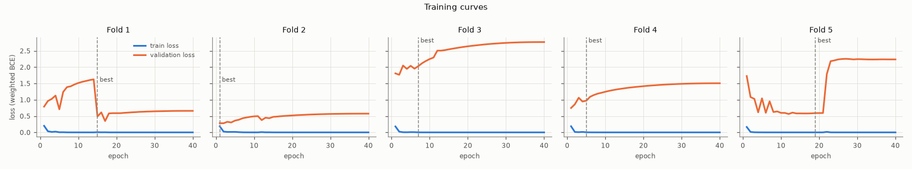
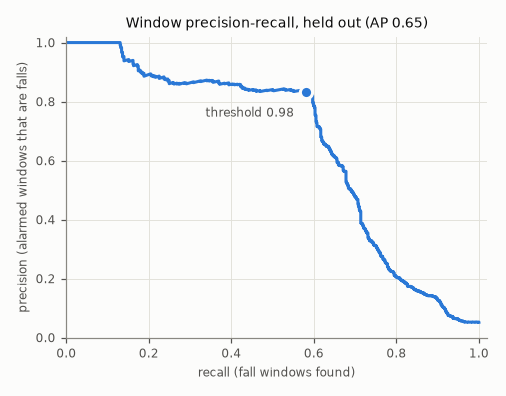
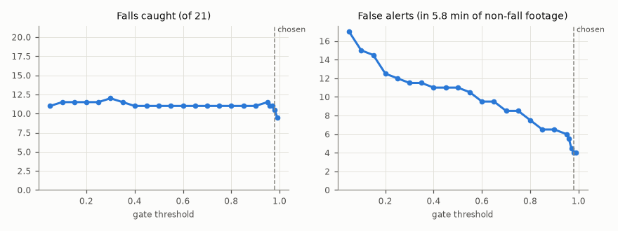
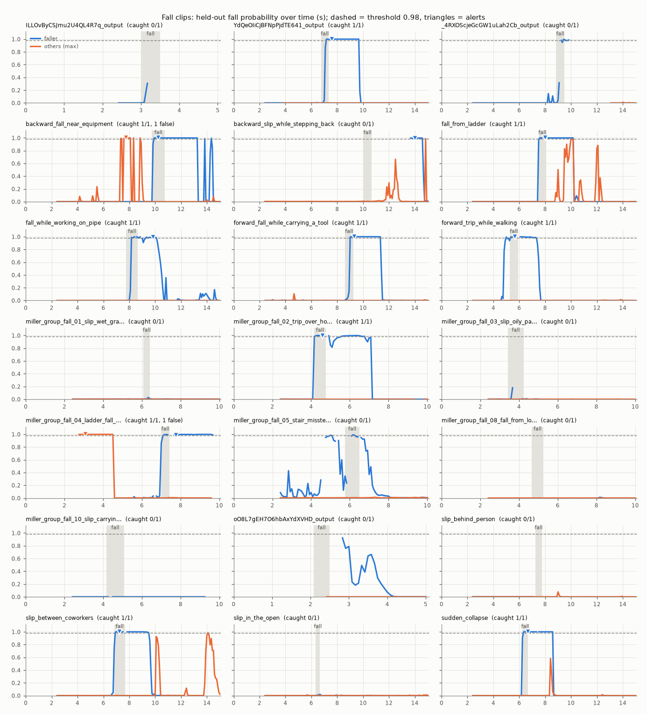
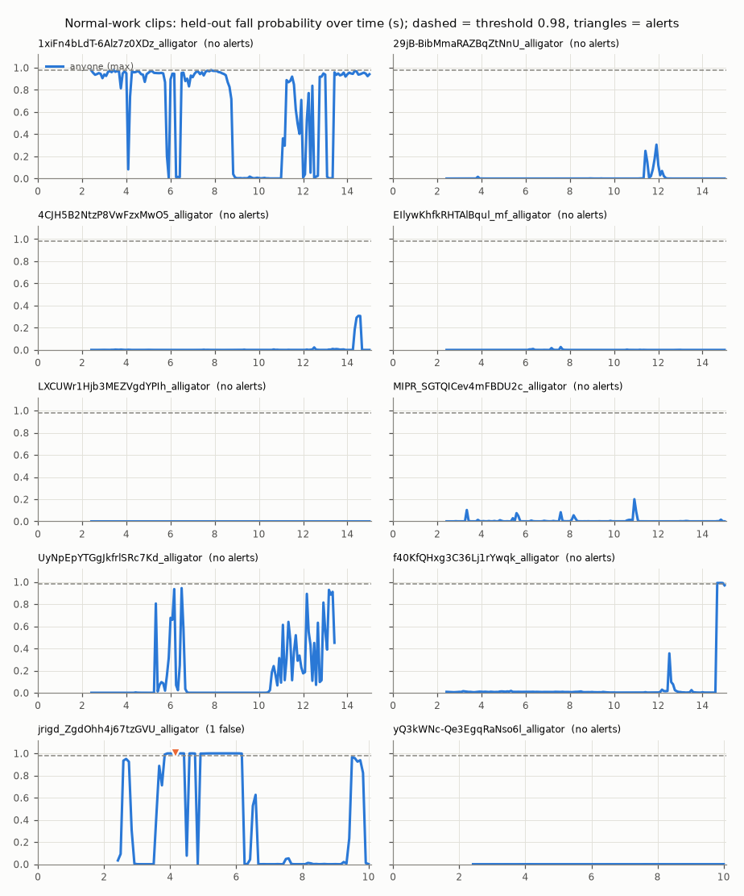

# Temporal model run: margin-synth200

2026-11-05T19:43:14 · commit `897c565+changes` · manifest.json: 131 clips, 71 falls

## Headline

At the chosen gate threshold **0.98** (mean of 2 seeds), held out by 5-fold grouped cross-validation (every clip tested once, by a model that never saw its scene):

- **Falls caught: 10.5 of 21** (50%), alert within 1.5 s of impact
- **False alerts: 4** in 5.8 min of non-fall footage (1.5 on the normal-work clips)
- Median alert time: +0.02 s relative to impact
- Late alerts (faller, after the catch window): 0.5
- Window-level: average precision 0.65, precision 0.83 / recall 0.58 at this threshold

> One false alert in 5.8 min is 10/hour, so this data cannot show the 1/hour target directly; the threshold is chosen for the fewest false alerts seen, then the most falls caught.

## Data and settings

- 31 clips (21 with a fall), 28 scene groups, 12 fps, windows of 30 frames (2.5 s), stride 1
- Model: GRU, hidden 64, dropout 0.1, up to 40 epochs (best by validation), learning rate 0.002
- Ambiguous windows (0-50% of a fall) left out: yes
- Augmented copies per training clip: 0; synthetic clips added: 200
- Gate: debounce 5 frames (0.42 s), cooldown 30 s
- Seeds: 0, 1
- Tested clips by source: rig 31 (21 falls)
- External clips added to every training set (never tested): none

## Threshold trade-off

| Threshold | Falls caught | False alerts | Per hour | Normal-clip false | Median alert time | Window precision | Window recall |
|---:|---:|---:|---:|---:|---:|---:|---:|
| 0.05 | 11/21 | 17 | 176 | 7 | -0.12 s | 0.50 | 0.69 |
| 0.10 | 11.5/21 | 15 | 155 | 6.5 | -0.10 s | 0.55 | 0.68 |
| 0.15 | 11.5/21 | 14.5 | 150 | 6 | -0.10 s | 0.57 | 0.67 |
| 0.20 | 11.5/21 | 12.5 | 130 | 5.5 | -0.08 s | 0.58 | 0.67 |
| 0.25 | 11.5/21 | 12 | 124 | 5.5 | -0.08 s | 0.59 | 0.66 |
| 0.30 | 12/21 | 11.5 | 119 | 5.5 | -0.10 s | 0.60 | 0.66 |
| 0.35 | 11.5/21 | 11.5 | 119 | 5.5 | -0.13 s | 0.60 | 0.66 |
| 0.40 | 11/21 | 11 | 114 | 5 | -0.12 s | 0.61 | 0.65 |
| 0.45 | 11/21 | 11 | 114 | 5 | -0.12 s | 0.61 | 0.65 |
| 0.50 | 11/21 | 11 | 114 | 5 | -0.12 s | 0.62 | 0.65 |
| 0.55 | 11/21 | 10.5 | 109 | 5 | -0.12 s | 0.62 | 0.64 |
| 0.60 | 11/21 | 9.5 | 98 | 5 | -0.12 s | 0.63 | 0.64 |
| 0.65 | 11/21 | 9.5 | 98 | 5 | -0.12 s | 0.64 | 0.64 |
| 0.70 | 11/21 | 8.5 | 88 | 4.5 | -0.12 s | 0.65 | 0.64 |
| 0.75 | 11/21 | 8.5 | 88 | 4.5 | -0.12 s | 0.65 | 0.63 |
| 0.80 | 11/21 | 7.5 | 78 | 4 | -0.08 s | 0.65 | 0.63 |
| 0.85 | 11/21 | 6.5 | 67 | 3 | -0.08 s | 0.67 | 0.62 |
| 0.90 | 11/21 | 6.5 | 67 | 3 | -0.08 s | 0.70 | 0.62 |
| 0.95 | 11.5/21 | 6 | 62 | 3 | -0.08 s | 0.76 | 0.60 |
| 0.96 | 11/21 | 5.5 | 57 | 2.5 | -0.08 s | 0.79 | 0.60 |
| 0.97 | 11/21 | 4.5 | 47 | 1.5 | -0.04 s | 0.81 | 0.60 |
| 0.98 **(chosen)** | 10.5/21 | 4 | 41 | 1.5 | +0.02 s | 0.83 | 0.58 |
| 0.99 | 9.5/21 | 4 | 41 | 1.5 | +0.00 s | 0.84 | 0.55 |

## Folds

| Seed | Fold | Test clips | Train windows (falls) | Test windows (falls) | Best epoch | Avg precision | F1 @0.5 |
|---:|---:|---:|---:|---:|---:|---:|---:|
| 0 | 1 | 9 | 10453 (1565) | 1552 (113) | 15 | 0.92 | 0.83 |
| 0 | 2 | 6 | 10640 (1861) | 1397 (87) | 1 | 0.33 | 0.28 |
| 0 | 3 | 6 | 9906 (1696) | 2091 (112) | 7 | 0.80 | 0.78 |
| 0 | 4 | 5 | 9850 (1734) | 1512 (34) | 5 | 0.13 | 0.00 |
| 0 | 5 | 5 | 10519 (1753) | 1797 (87) | 19 | 0.65 | 0.75 |
| 1 | 1 | 9 | 10386 (1594) | 1552 (113) | 4 | 0.97 | 0.80 |
| 1 | 2 | 6 | 10198 (1606) | 1397 (87) | 10 | 0.47 | 0.43 |
| 1 | 3 | 6 | 9336 (1742) | 2091 (112) | 3 | 0.55 | 0.71 |
| 1 | 4 | 5 | 9844 (2097) | 1512 (34) | 11 | 0.61 | 0.57 |
| 1 | 5 | 5 | 10056 (1516) | 1797 (87) | 1 | 0.44 | 0.48 |

## Per clip (at the chosen threshold)

| Clip | Fold | Fall (s) | Fall windows | Caught | Alert time | False alerts | Peak p faller | Peak p others |
|---|---:|---|---:|---:|---:|---:|---:|---:|
| 1xiFn4bLdT-6Alz7z0XDz_alligator | 2 | - | - | - | - | 0 | - | 0.95 |
| 29jB-BibMmaRAZBqZtNnU_alligator | 5 | - | - | - | - | 0 | - | 0.64 |
| 4CJH5B2NtzP8VwFzxMwO5_alligator | 4 | - | - | - | - | 0 | - | 0.16 |
| EIlywKhfkRHTAlBqul_mf_alligator | 3 | - | - | - | - | 0 | - | 0.06 |
| ILLOvByCSJmu2U4QL4R7q_output | 1 | 3.00-3.50 | 0 | 0/2 | - | 0 | 0.16 | - |
| LXCUWr1Hjb3MEZVgdYPIh_alligator | 5 | - | - | - | - | 0 | - | 0.06 |
| MIPR_SGTQICev4mFBDU2c_alligator | 4 | - | - | - | - | 0 | - | 0.38 |
| UyNpEpYTGgJkfrlSRc7Kd_alligator | 1 | - | - | - | - | 0 | - | 0.97 |
| YdQeOIiCjBFNpPjdTE641_output | 1 | 6.75-7.33 | 28 | 2/2 | +0.25 | 0 | 1.00 | 0.00 |
| _4RXOScjeGcGW1uLah2Cb_output | 1 | 8.83-9.50 | 8 | 1/2 | +0.17 | 0 | 1.00 | 0.01 |
| backward_fall_near_equipment | 5 | 9.75-10.75 | 30 | 2/2 | -0.46 | 1 | 1.00 | 0.95 |
| backward_slip_while_stepping_back | 2 | 10.00-10.67 | 3 | 0/2 | - | 0 | 0.50 | 0.99 |
| f40KfQHxg3C36Lj1rYwqk_alligator | 2 | - | - | - | - | 1 | - | 1.00 |
| fall_from_ladder | 3 | 7.50-8.08 | 27 | 2/2 | -0.08 | 0 | 1.00 | 0.60 |
| fall_while_working_on_pipe | 1 | 7.75-8.67 | 27 | 2/2 | +0.75 | 0 | 1.00 | 0.00 |
| forward_fall_while_carrying_a_tool | 3 | 8.58-9.25 | 30 | 2/2 | +0.04 | 0 | 1.00 | 0.32 |
| forward_trip_while_walking | 3 | 5.25-5.92 | 28 | 1/2 | -0.25 | 0 | 1.00 | 0.11 |
| jrigd_ZgdOhh4j67tzGVU_alligator | 3 | - | - | - | - | 2 | - | 1.00 |
| miller_group_fall_01_slip_wet_grating | 2 | 6.08-6.42 | 30 | 0/2 | - | 0 | 0.02 | 0.00 |
| miller_group_fall_02_trip_over_hose | 1 | 4.17-4.75 | 26 | 2/2 | -0.12 | 0 | 1.00 | 0.00 |
| miller_group_fall_03_slip_oily_patch_drizzle | 4 | 3.42-4.25 | 8 | 0/2 | - | 0 | 0.10 | 0.00 |
| miller_group_fall_04_ladder_fall_pipe_rack | 2 | 7.00-7.42 | 26 | 1/2 | +0.33 | 3 | 1.00 | 1.00 |
| miller_group_fall_05_stair_misstep_night | 2 | 5.75-6.50 | 28 | 1/2 | +0.08 | 0 | 1.00 | 0.01 |
| miller_group_fall_08_fall_from_low_platform | 4 | 4.67-5.25 | 0 | 0/2 | - | 0 | 0.01 | 0.00 |
| miller_group_fall_10_slip_carrying_toolbox_night_rain | 5 | 4.17-5.08 | 29 | 0/2 | - | 0 | 0.19 | - |
| oO8L7gEH7O6hbAxYdXVHD_output | 1 | 2.08-2.50 | 24 | 1/2 | +0.58 | 0 | 1.00 | 0.00 |
| slip_behind_person | 1 | 7.25-7.75 | 0 | 0/2 | - | 0 | 0.00 | 0.51 |
| slip_between_coworkers | 3 | 6.83-7.67 | 27 | 2/2 | -0.54 | 0 | 1.00 | 0.95 |
| slip_in_the_open | 4 | 6.33-6.67 | 26 | 1/2 | +1.50 | 1 | 0.51 | 0.51 |
| sudden_collapse | 5 | 6.25-6.67 | 28 | 1/2 | +0.00 | 0 | 0.92 | 0.72 |
| yQ3kWNc-Qe3EgqRaNso6l_alligator | 1 | - | - | - | - | 0 | - | 0.30 |

## Notes

- 3 fall clip(s) give no fall windows because the pose detector loses the faller mid-fall: ILLOvByCSJmu2U4QL4R7q_output, miller_group_fall_08_fall_from_low_platform, slip_behind_person. They can only be caught if the model fires on the onset.

## Plots

