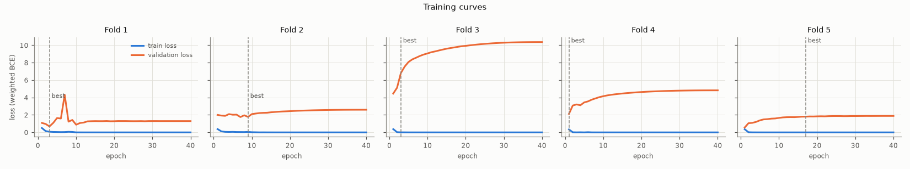
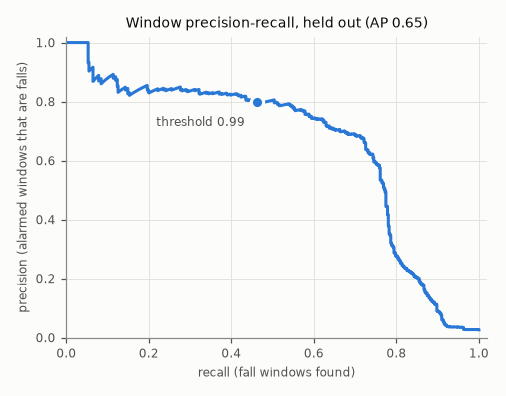
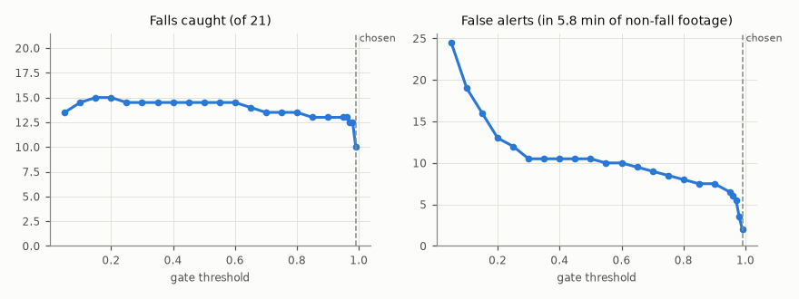
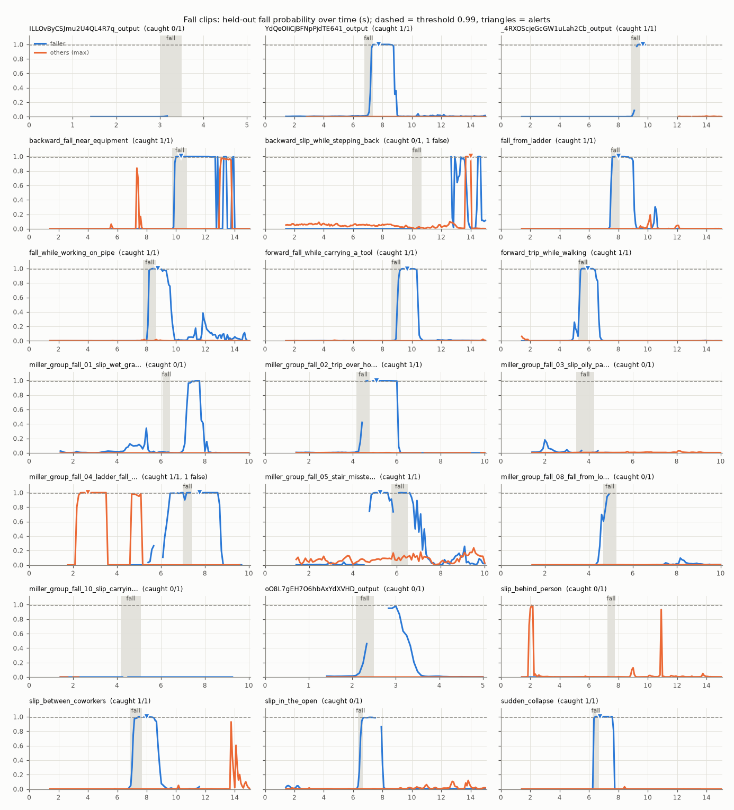
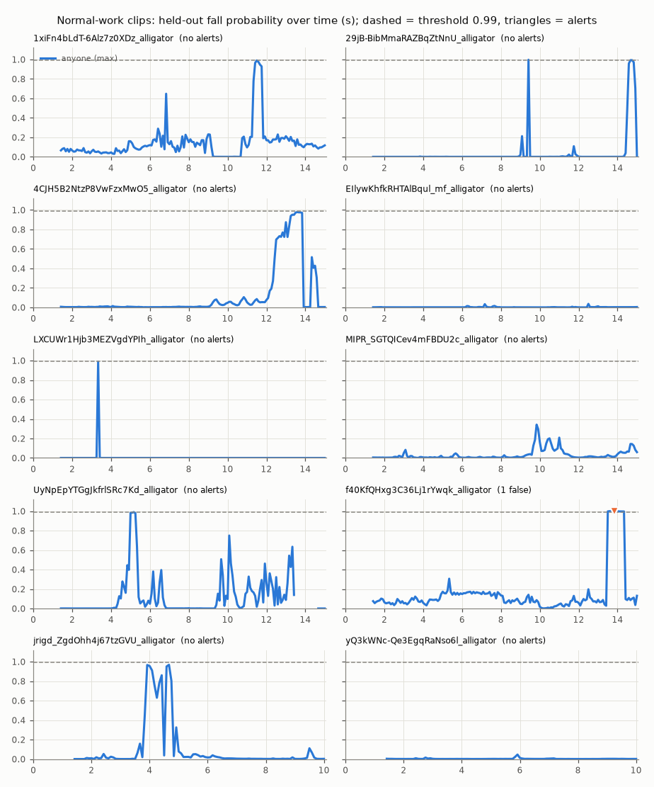

# Temporal model run: rig-only-win18

2026-11-05T20:11:01 · commit `897c565+changes` · manifest.json: 131 clips, 71 falls

## Headline

At the chosen gate threshold **0.99** (mean of 2 seeds), held out by 5-fold grouped cross-validation (every clip tested once, by a model that never saw its scene):

- **Falls caught: 10 of 21** (48%), alert within 1.5 s of impact
- **False alerts: 2** in 5.8 min of non-fall footage (1 on the normal-work clips)
- Median alert time: +0.08 s relative to impact
- Late alerts (faller, after the catch window): 0
- Window-level: average precision 0.65, precision 0.80 / recall 0.46 at this threshold

> One false alert in 5.8 min is 10/hour, so this data cannot show the 1/hour target directly; the threshold is chosen for the fewest false alerts seen, then the most falls caught.

## Data and settings

- 31 clips (21 with a fall), 28 scene groups, 12 fps, windows of 18 frames (1.5 s), stride 1
- Model: GRU, hidden 64, dropout 0.1, up to 40 epochs (best by validation), learning rate 0.002
- Ambiguous windows (0-50% of a fall) left out: yes
- Augmented copies per training clip: 0; synthetic clips added: 0
- Gate: debounce 5 frames (0.42 s), cooldown 30 s
- Seeds: 0, 1
- Tested clips by source: rig 31 (21 falls)
- External clips added to every training set (never tested): none

## Threshold trade-off

| Threshold | Falls caught | False alerts | Per hour | Normal-clip false | Median alert time | Window precision | Window recall |
|---:|---:|---:|---:|---:|---:|---:|---:|
| 0.05 | 13.5/21 | 24.5 | 254 | 12.5 | -0.12 s | 0.25 | 0.81 |
| 0.10 | 14.5/21 | 19 | 197 | 12 | -0.10 s | 0.32 | 0.79 |
| 0.15 | 15/21 | 16 | 166 | 11 | -0.08 s | 0.38 | 0.78 |
| 0.20 | 15/21 | 13 | 135 | 8.5 | -0.08 s | 0.44 | 0.78 |
| 0.25 | 14.5/21 | 12 | 124 | 7.5 | -0.04 s | 0.48 | 0.77 |
| 0.30 | 14.5/21 | 10.5 | 109 | 6.5 | -0.04 s | 0.52 | 0.77 |
| 0.35 | 14.5/21 | 10.5 | 109 | 6.5 | -0.02 s | 0.54 | 0.76 |
| 0.40 | 14.5/21 | 10.5 | 109 | 6.5 | -0.02 s | 0.56 | 0.76 |
| 0.45 | 14.5/21 | 10.5 | 109 | 6.5 | +0.00 s | 0.58 | 0.76 |
| 0.50 | 14.5/21 | 10.5 | 109 | 6.5 | +0.02 s | 0.60 | 0.75 |
| 0.55 | 14.5/21 | 10 | 104 | 6 | +0.02 s | 0.61 | 0.75 |
| 0.60 | 14.5/21 | 10 | 104 | 6 | +0.02 s | 0.63 | 0.74 |
| 0.65 | 14/21 | 9.5 | 98 | 5.5 | +0.04 s | 0.64 | 0.73 |
| 0.70 | 13.5/21 | 9 | 93 | 5 | +0.02 s | 0.66 | 0.73 |
| 0.75 | 13.5/21 | 8.5 | 88 | 4.5 | +0.02 s | 0.67 | 0.72 |
| 0.80 | 13.5/21 | 8 | 83 | 4 | +0.02 s | 0.68 | 0.71 |
| 0.85 | 13/21 | 7.5 | 78 | 4 | +0.00 s | 0.69 | 0.70 |
| 0.90 | 13/21 | 7.5 | 78 | 4 | +0.00 s | 0.70 | 0.68 |
| 0.95 | 13/21 | 6.5 | 67 | 3 | +0.04 s | 0.71 | 0.64 |
| 0.96 | 13/21 | 6 | 62 | 3 | +0.04 s | 0.73 | 0.63 |
| 0.97 | 12.5/21 | 5.5 | 57 | 2.5 | +0.06 s | 0.74 | 0.59 |
| 0.98 | 12.5/21 | 3.5 | 36 | 1.5 | +0.10 s | 0.78 | 0.55 |
| 0.99 **(chosen)** | 10/21 | 2 | 21 | 1 | +0.08 s | 0.80 | 0.46 |

## Folds

| Seed | Fold | Test clips | Train windows (falls) | Test windows (falls) | Best epoch | Avg precision | F1 @0.5 |
|---:|---:|---:|---:|---:|---:|---:|---:|
| 0 | 1 | 9 | 7099 (158) | 1882 (66) | 3 | 0.93 | 0.87 |
| 0 | 2 | 6 | 7259 (182) | 1672 (51) | 9 | 0.36 | 0.45 |
| 0 | 3 | 6 | 6523 (159) | 2409 (64) | 3 | 0.93 | 0.85 |
| 0 | 4 | 5 | 6539 (212) | 1687 (23) | 1 | 0.61 | 0.53 |
| 0 | 5 | 5 | 6803 (174) | 2072 (51) | 17 | 0.63 | 0.63 |
| 1 | 1 | 9 | 7270 (173) | 1882 (66) | 1 | 0.91 | 0.87 |
| 1 | 2 | 6 | 6685 (170) | 1672 (51) | 1 | 0.29 | 0.28 |
| 1 | 3 | 6 | 5998 (140) | 2409 (64) | 2 | 0.91 | 0.83 |
| 1 | 4 | 5 | 6527 (199) | 1687 (23) | 4 | 0.67 | 0.70 |
| 1 | 5 | 5 | 6845 (190) | 2072 (51) | 3 | 0.58 | 0.67 |

## Per clip (at the chosen threshold)

| Clip | Fold | Fall (s) | Fall windows | Caught | Alert time | False alerts | Peak p faller | Peak p others |
|---|---:|---|---:|---:|---:|---:|---:|---:|
| 1xiFn4bLdT-6Alz7z0XDz_alligator | 2 | - | - | - | - | 0 | - | 0.99 |
| 29jB-BibMmaRAZBqZtNnU_alligator | 5 | - | - | - | - | 0 | - | 1.00 |
| 4CJH5B2NtzP8VwFzxMwO5_alligator | 4 | - | - | - | - | 0 | - | 0.84 |
| EIlywKhfkRHTAlBqul_mf_alligator | 3 | - | - | - | - | 0 | - | 0.44 |
| ILLOvByCSJmu2U4QL4R7q_output | 1 | 3.00-3.50 | 0 | 0/2 | - | 0 | 0.03 | - |
| LXCUWr1Hjb3MEZVgdYPIh_alligator | 5 | - | - | - | - | 0 | - | 0.50 |
| MIPR_SGTQICev4mFBDU2c_alligator | 4 | - | - | - | - | 0 | - | 0.25 |
| UyNpEpYTGgJkfrlSRc7Kd_alligator | 1 | - | - | - | - | 0 | - | 0.99 |
| YdQeOIiCjBFNpPjdTE641_output | 1 | 6.75-7.33 | 16 | 2/2 | +0.50 | 0 | 1.00 | 0.01 |
| _4RXOScjeGcGW1uLah2Cb_output | 1 | 8.83-9.50 | 8 | 2/2 | +0.21 | 0 | 1.00 | 0.06 |
| backward_fall_near_equipment | 5 | 9.75-10.75 | 18 | 2/2 | -0.42 | 0 | 1.00 | 0.81 |
| backward_slip_while_stepping_back | 2 | 10.00-10.67 | 3 | 0/2 | - | 1 | 0.99 | 1.00 |
| f40KfQHxg3C36Lj1rYwqk_alligator | 2 | - | - | - | - | 2 | - | 1.00 |
| fall_from_ladder | 3 | 7.50-8.08 | 15 | 2/2 | -0.08 | 0 | 1.00 | 0.17 |
| fall_while_working_on_pipe | 1 | 7.75-8.67 | 15 | 2/2 | +0.13 | 0 | 1.00 | 0.04 |
| forward_fall_while_carrying_a_tool | 3 | 8.58-9.25 | 18 | 2/2 | +0.25 | 0 | 1.00 | 0.47 |
| forward_trip_while_walking | 3 | 5.25-5.92 | 16 | 2/2 | +0.00 | 0 | 1.00 | 0.42 |
| jrigd_ZgdOhh4j67tzGVU_alligator | 3 | - | - | - | - | 0 | - | 0.98 |
| miller_group_fall_01_slip_wet_grating | 2 | 6.08-6.42 | 18 | 0/2 | - | 0 | 0.98 | 0.00 |
| miller_group_fall_02_trip_over_hose | 1 | 4.17-4.75 | 14 | 1/2 | +0.33 | 0 | 1.00 | 0.04 |
| miller_group_fall_03_slip_oily_patch_drizzle | 4 | 3.42-4.25 | 8 | 0/2 | - | 0 | 0.11 | 0.06 |
| miller_group_fall_04_ladder_fall_pipe_rack | 2 | 7.00-7.42 | 14 | 1/2 | +0.33 | 1 | 1.00 | 0.99 |
| miller_group_fall_05_stair_misstep_night | 2 | 5.75-6.50 | 16 | 1/2 | -1.25 | 0 | 1.00 | 0.13 |
| miller_group_fall_08_fall_from_low_platform | 4 | 4.67-5.25 | 1 | 0/2 | - | 0 | 0.98 | 0.07 |
| miller_group_fall_10_slip_carrying_toolbox_night_rain | 5 | 4.17-5.08 | 17 | 0/2 | - | 0 | 0.01 | 0.00 |
| oO8L7gEH7O6hbAxYdXVHD_output | 1 | 2.08-2.50 | 13 | 0/2 | - | 0 | 0.98 | 0.00 |
| slip_behind_person | 1 | 7.25-7.75 | 0 | 0/2 | - | 0 | 0.00 | 0.99 |
| slip_between_coworkers | 3 | 6.83-7.67 | 15 | 2/2 | +0.04 | 0 | 1.00 | 0.95 |
| slip_in_the_open | 4 | 6.33-6.67 | 14 | 0/2 | - | 0 | 0.99 | 0.52 |
| sudden_collapse | 5 | 6.25-6.67 | 16 | 1/2 | +0.08 | 0 | 1.00 | 0.10 |
| yQ3kWNc-Qe3EgqRaNso6l_alligator | 1 | - | - | - | - | 0 | - | 0.14 |

## Notes

- 2 fall clip(s) give no fall windows because the pose detector loses the faller mid-fall: ILLOvByCSJmu2U4QL4R7q_output, slip_behind_person. They can only be caught if the model fires on the onset.

## Plots

