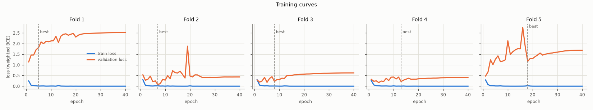
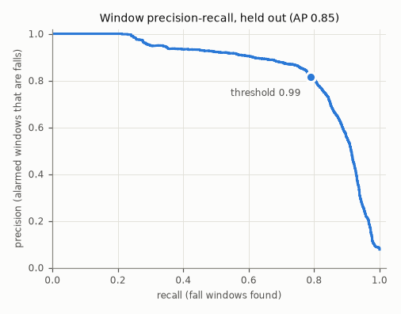
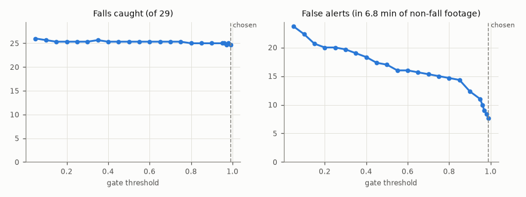

# Temporal model run: t2-gap12

2026-11-15T22:32:44 · commit `3fa0f41+changes` · manifest.json: 161 clips, 101 falls

## Headline

At the chosen gate threshold **0.99** (mean of 3 seeds), held out by 5-fold grouped cross-validation (every clip tested once, by a model that never saw its scene):

- **Falls caught: 24.6667 of 29** (85%), alert within 1.5 s of impact
- **False alerts: 7.66667** in 6.8 min of non-fall footage (7.66667 on the normal-work clips)
- Median alert time: +0.12 s relative to impact
- Late alerts (faller, after the catch window): 1.66667
- Window-level: average precision 0.85, precision 0.82 / recall 0.79 at this threshold
- **Honest estimate (threshold chosen without the tested fold): 24.6667 of 29 caught, 8.33333 false alerts.** Each fold's threshold (0.96, 0.98, 0.99) was picked from the other folds only, so these are the numbers to compare between runs.
- Seed to seed: falls caught 24 to 25, false alerts 7 to 9 (the run-to-run noise; differences between runs smaller than this are not real)

> One false alert in 6.8 min is 9/hour, so this data cannot show the 1/hour target directly; the threshold is chosen for the fewest false alerts seen, then the most falls caught.

## Data and settings

- 39 clips (29 with a fall), 36 scene groups, 11.9998 fps, windows of 30 frames (2.5 s), stride 1
- Model: GRU, hidden 64, dropout 0.1, up to 40 epochs (best by validation), learning rate 0.002
- Ambiguous windows (0-50% of a fall) left out: yes
- Augmentation: 0 augmented copies per training clip; synthetic clips added: 0
- Label smoothing: 0; low-posture normal windows weighted x1
- Tracking: a lost track continues for up to 12 frames (1.00 s); duplicate boxes on one body kept
- Gate: debounce 5 frames (0.42 s), cooldown 30 s
- Fast-drop check: off
- Seeds: 0, 1, 2
- Tested clips by source: rig 39 (29 falls)
- External clips added to every training set (never tested): caucafall 88 (38 falls), gym 22 (22 falls)

## Threshold trade-off

| Threshold | Falls caught | False alerts | Per hour | Normal-clip false | Median alert time | Window precision | Window recall |
|---:|---:|---:|---:|---:|---:|---:|---:|
| 0.05 | 26/29 | 23.6667 | 209 | 19.3333 | -0.14 s | 0.58 | 0.89 |
| 0.10 | 25.6667/29 | 22.3333 | 197 | 18.6667 | -0.07 s | 0.62 | 0.88 |
| 0.15 | 25.3333/29 | 20.6667 | 182 | 17.6667 | -0.07 s | 0.63 | 0.88 |
| 0.20 | 25.3333/29 | 20 | 177 | 17 | -0.06 s | 0.65 | 0.87 |
| 0.25 | 25.3333/29 | 20 | 177 | 17 | -0.06 s | 0.65 | 0.87 |
| 0.30 | 25.3333/29 | 19.6667 | 174 | 17 | -0.04 s | 0.66 | 0.86 |
| 0.35 | 25.6667/29 | 19 | 168 | 17 | +0.00 s | 0.67 | 0.86 |
| 0.40 | 25.3333/29 | 18.3333 | 162 | 16.3333 | +0.00 s | 0.67 | 0.86 |
| 0.45 | 25.3333/29 | 17.3333 | 153 | 15.6667 | +0.00 s | 0.68 | 0.85 |
| 0.50 | 25.3333/29 | 17 | 150 | 15.3333 | +0.00 s | 0.69 | 0.85 |
| 0.55 | 25.3333/29 | 16 | 141 | 14.3333 | +0.00 s | 0.70 | 0.85 |
| 0.60 | 25.3333/29 | 16 | 141 | 14.3333 | +0.00 s | 0.71 | 0.85 |
| 0.65 | 25.3333/29 | 15.6667 | 138 | 14 | +0.01 s | 0.72 | 0.85 |
| 0.70 | 25.3333/29 | 15.3333 | 135 | 13.6667 | +0.01 s | 0.72 | 0.84 |
| 0.75 | 25.3333/29 | 15 | 132 | 13.3333 | +0.01 s | 0.73 | 0.84 |
| 0.80 | 25/29 | 14.6667 | 129 | 13 | +0.03 s | 0.74 | 0.84 |
| 0.85 | 25/29 | 14.3333 | 126 | 13 | +0.06 s | 0.74 | 0.83 |
| 0.90 | 25/29 | 12.3333 | 109 | 11.3333 | +0.07 s | 0.75 | 0.83 |
| 0.95 | 25/29 | 11 | 97 | 10 | +0.08 s | 0.77 | 0.82 |
| 0.96 | 25/29 | 10 | 88 | 9 | +0.10 s | 0.78 | 0.81 |
| 0.97 | 24.6667/29 | 9 | 79 | 8.33333 | +0.08 s | 0.79 | 0.81 |
| 0.98 | 25/29 | 8.33333 | 74 | 8 | +0.11 s | 0.80 | 0.80 |
| 0.99 **(chosen)** | 24.6667/29 | 7.66667 | 68 | 7.66667 | +0.12 s | 0.82 | 0.79 |

## Fast-drop check (at the chosen threshold)

What requiring a fast body drop before an alert would change. The run's own setting is marked.

| Minimum drop (body lengths in 0.75 s) | Falls caught | False alerts |
|---:|---:|---:|
| off **(this run)** | 24.6667/29 | 7.66667 |
| 0.05 | 24.6667/29 | 7.66667 |
| 0.1 | 24.6667/29 | 7.33333 |
| 0.15 | 24.6667/29 | 6.66667 |
| 0.2 | 24.3333/29 | 6 |
| 0.25 | 23.6667/29 | 3 |
| 0.3 | 21.6667/29 | 1.33333 |

## By batch (rig clips, at the chosen threshold)

`trial1` is exactly the clip set Trial 1 was scored on, so it compares directly with Trial 1's numbers. Later batches are the clips added since.

| Batch | Clips | Falls caught | False alerts | Non-fall minutes |
|---|---:|---:|---:|---:|
| trial1 | 31 | 19.6667/21 | 7.66667 | 5.8 |
| trial2 | 8 | 5/8 | 0 | 1.0 |

## Folds

| Seed | Fold | Test clips | Train windows (falls) | Test windows (falls) | Best epoch | Avg precision | F1 @0.5 |
|---:|---:|---:|---:|---:|---:|---:|---:|
| 0 | 1 | 11 | 15027 (1771) | 2055 (239) | 5 | 0.94 | 0.90 |
| 0 | 2 | 7 | 15620 (1910) | 1798 (113) | 7 | 0.83 | 0.68 |
| 0 | 3 | 7 | 15099 (1802) | 1995 (144) | 8 | 0.98 | 0.94 |
| 0 | 4 | 7 | 14865 (1777) | 2089 (168) | 13 | 0.81 | 0.78 |
| 0 | 5 | 7 | 14909 (1895) | 2434 (144) | 18 | 0.96 | 0.66 |
| 1 | 1 | 11 | 15226 (1792) | 2055 (239) | 3 | 0.90 | 0.82 |
| 1 | 2 | 7 | 15477 (1893) | 1798 (113) | 11 | 0.76 | 0.71 |
| 1 | 3 | 7 | 15403 (1895) | 1995 (144) | 22 | 0.98 | 0.85 |
| 1 | 4 | 7 | 15108 (1805) | 2089 (168) | 1 | 0.65 | 0.54 |
| 1 | 5 | 7 | 15138 (1891) | 2434 (144) | 13 | 0.95 | 0.70 |
| 2 | 1 | 11 | 14910 (1764) | 2055 (239) | 3 | 0.93 | 0.84 |
| 2 | 2 | 7 | 15122 (1832) | 1798 (113) | 1 | 0.67 | 0.63 |
| 2 | 3 | 7 | 15356 (1884) | 1995 (144) | 3 | 0.99 | 0.87 |
| 2 | 4 | 7 | 15004 (1855) | 2089 (168) | 8 | 0.81 | 0.76 |
| 2 | 5 | 7 | 14786 (1866) | 2434 (144) | 11 | 0.93 | 0.67 |

## Per clip (at the chosen threshold)

| Clip | Fold | Fall (s) | Fall windows | Caught | Alert time | False alerts | Peak p faller | Peak p others |
|---|---:|---|---:|---:|---:|---:|---:|---:|
| 1xiFn4bLdT-6Alz7z0XDz_alligator | 5 | - | - | - | - | 5 | - | 1.00 |
| 29jB-BibMmaRAZBqZtNnU_alligator | 3 | - | - | - | - | 2 | - | 0.95 |
| 4CJH5B2NtzP8VwFzxMwO5_alligator | 1 | - | - | - | - | 0 | - | 0.30 |
| EIlywKhfkRHTAlBqul_mf_alligator | 2 | - | - | - | - | 2 | - | 0.99 |
| ILLOvByCSJmu2U4QL4R7q_output | 1 | 3.00-3.50 | 22 | 3/3 | +0.11 | 0 | 1.00 | - |
| LXCUWr1Hjb3MEZVgdYPIh_alligator | 2 | - | - | - | - | 1 | - | 1.00 |
| MIPR_SGTQICev4mFBDU2c_alligator | 3 | - | - | - | - | 0 | - | 0.44 |
| UyNpEpYTGgJkfrlSRc7Kd_alligator | 5 | - | - | - | - | 7 | - | 1.00 |
| YdQeOIiCjBFNpPjdTE641_output | 1 | 6.75-7.33 | 29 | 3/3 | +0.39 | 0 | 1.00 | - |
| _4RXOScjeGcGW1uLah2Cb_output | 1 | 8.83-9.50 | 29 | 3/3 | +0.44 | 0 | 1.00 | - |
| backward_fall_near_equipment | 4 | 9.75-10.75 | 30 | 3/3 | -0.31 | 0 | 1.00 | 0.09 |
| backward_slip_while_stepping_back | 5 | 10.00-10.67 | 26 | 3/3 | +0.42 | 0 | 1.00 | 0.03 |
| f40KfQHxg3C36Lj1rYwqk_alligator | 4 | - | - | - | - | 1 | - | 0.77 |
| fall_from_ladder | 1 | 7.50-8.08 | 25 | 3/3 | +0.11 | 0 | 1.00 | 0.33 |
| fall_while_working_on_pipe | 2 | 7.75-8.67 | 29 | 3/3 | -0.11 | 0 | 1.00 | 0.08 |
| forward_fall_while_carrying_a_tool | 5 | 8.58-9.25 | 30 | 3/3 | -0.03 | 0 | 1.00 | 0.42 |
| forward_trip_while_walking | 3 | 5.25-5.92 | 30 | 3/3 | -0.06 | 0 | 1.00 | 0.01 |
| jrigd_ZgdOhh4j67tzGVU_alligator | 1 | - | - | - | - | 4 | - | 1.00 |
| miller_group_fall_01_slip_wet_grating | 4 | 6.08-6.42 | 30 | 1/3 | +1.08 | 0 | 0.76 | 0.00 |
| miller_group_fall_02_trip_over_hose | 3 | 4.17-4.75 | 29 | 3/3 | -0.03 | 0 | 1.00 | 0.01 |
| miller_group_fall_03_slip_oily_patch_drizzle | 4 | 3.42-4.25 | 30 | 3/3 | -0.03 | 0 | 1.00 | 0.01 |
| miller_group_fall_04_ladder_fall_pipe_rack | 3 | 7.00-7.42 | 29 | 3/3 | +0.22 | 0 | 1.00 | 0.00 |
| miller_group_fall_05_stair_misstep_night | 4 | 5.75-6.50 | 29 | 2/3 | +0.08 | 0 | 0.99 | 0.00 |
| miller_group_fall_08_fall_from_low_platform | 1 | 4.67-5.25 | 29 | 3/3 | -0.03 | 0 | 1.00 | 0.01 |
| miller_group_fall_10_slip_carrying_toolbox_night_rain | 3 | 4.17-5.08 | 29 | 3/3 | -0.19 | 0 | 1.00 | 0.01 |
| miller_night_fall_01_nv_slip_wet_grating | 2 | 5.42-6.08 | 2 | 0/3 | - | 0 | 0.87 | 0.00 |
| miller_night_fall_02_nv_trip_over_hose | 1 | 4.25-4.83 | 19 | 0/3 | - | 0 | 0.07 | 0.00 |
| miller_night_fall_05_nv_stumble_carrying_pipe | 4 | 4.92-5.42 | 49 | 3/3 | +1.31 | 0 | 1.00 | 0.00 |
| miller_night_fall_06_oh_slip_oily_patch | 1 | 4.00-4.50 | 30 | 3/3 | -0.17 | 0 | 1.00 | 0.30 |
| miller_night_fall_07_oh_trip_over_flange | 2 | 4.08-4.50 | 28 | 0/3 | - | 0 | 1.00 | 0.01 |
| miller_night_fall_08_oh_fall_from_low_platform | 1 | 4.92-5.50 | 28 | 3/3 | +0.44 | 0 | 1.00 | 0.03 |
| miller_night_fall_09_oh_slip_stepping_off_ladder | 5 | 5.08-5.58 | 30 | 3/3 | +0.28 | 0 | 1.00 | 0.03 |
| miller_night_fall_10_oh_slip_carrying_toolbox_alone | 2 | 4.42-4.83 | 24 | 3/3 | +0.61 | 0 | 1.00 | 0.00 |
| oO8L7gEH7O6hbAxYdXVHD_output | 1 | 2.08-2.50 | 28 | 3/3 | +0.25 | 0 | 1.00 | 0.01 |
| slip_behind_person | 3 | 7.25-7.75 | 27 | 3/3 | +0.33 | 0 | 1.00 | 0.64 |
| slip_between_coworkers | 5 | 6.83-7.67 | 29 | 3/3 | -0.36 | 0 | 1.00 | 0.16 |
| slip_in_the_open | 2 | 6.33-6.67 | 30 | 2/3 | +0.54 | 0 | 1.00 | 0.41 |
| sudden_collapse | 5 | 6.25-6.67 | 29 | 3/3 | -0.06 | 0 | 1.00 | 0.09 |
| yQ3kWNc-Qe3EgqRaNso6l_alligator | 4 | - | - | - | - | 1 | - | 0.99 |

## Plots

