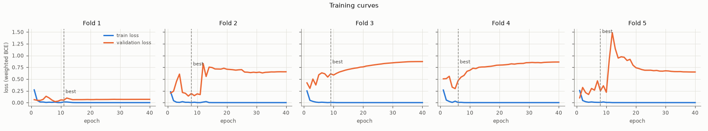
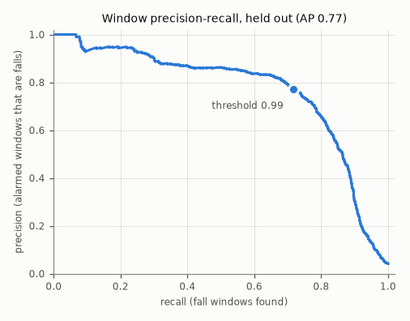
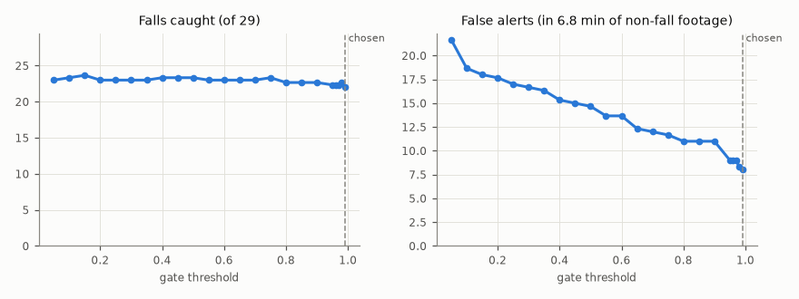

# Temporal model run: t2-win18

2026-11-15T20:09:12 · commit `3fa0f41+changes` · manifest.json: 161 clips, 101 falls

## Headline

At the chosen gate threshold **0.99** (mean of 3 seeds), held out by 5-fold grouped cross-validation (every clip tested once, by a model that never saw its scene):

- **Falls caught: 22 of 29** (76%), alert within 1.5 s of impact
- **False alerts: 8** in 6.8 min of non-fall footage (6 on the normal-work clips)
- Median alert time: +0.07 s relative to impact
- Late alerts (faller, after the catch window): 0.666667
- Window-level: average precision 0.77, precision 0.77 / recall 0.72 at this threshold
- **Honest estimate (threshold chosen without the tested fold): 22 of 29 caught, 9 false alerts.** Each fold's threshold (0.97, 0.98, 0.99) was picked from the other folds only, so these are the numbers to compare between runs.
- Seed to seed: falls caught 22 to 22, false alerts 6 to 9 (the run-to-run noise; differences between runs smaller than this are not real)

> One false alert in 6.8 min is 9/hour, so this data cannot show the 1/hour target directly; the threshold is chosen for the fewest false alerts seen, then the most falls caught.

## Data and settings

- 39 clips (29 with a fall), 36 scene groups, 11.9998 fps, windows of 18 frames (1.5 s), stride 1
- Model: GRU, hidden 64, dropout 0.1, up to 40 epochs (best by validation), learning rate 0.002
- Ambiguous windows (0-50% of a fall) left out: yes
- Augmentation: 0 augmented copies per training clip; synthetic clips added: 0
- Label smoothing: 0; low-posture normal windows weighted x1
- Tracking: a lost track continues for up to 5 frames (0.42 s); duplicate boxes on one body kept
- Gate: debounce 5 frames (0.42 s), cooldown 30 s
- Fast-drop check: off
- Seeds: 0, 1, 2
- Tested clips by source: rig 39 (29 falls)
- External clips added to every training set (never tested): caucafall 88 (38 falls), gym 22 (22 falls)

## Threshold trade-off

| Threshold | Falls caught | False alerts | Per hour | Normal-clip false | Median alert time | Window precision | Window recall |
|---:|---:|---:|---:|---:|---:|---:|---:|
| 0.05 | 23/29 | 21.6667 | 191 | 15 | -0.10 s | 0.55 | 0.84 |
| 0.10 | 23.3333/29 | 18.6667 | 165 | 13 | -0.10 s | 0.58 | 0.83 |
| 0.15 | 23.6667/29 | 18 | 159 | 13 | -0.08 s | 0.59 | 0.82 |
| 0.20 | 23/29 | 17.6667 | 156 | 12.6667 | -0.08 s | 0.61 | 0.82 |
| 0.25 | 23/29 | 17 | 150 | 12 | -0.08 s | 0.62 | 0.82 |
| 0.30 | 23/29 | 16.6667 | 147 | 12 | -0.08 s | 0.63 | 0.81 |
| 0.35 | 23/29 | 16.3333 | 144 | 11.6667 | -0.08 s | 0.64 | 0.81 |
| 0.40 | 23.3333/29 | 15.3333 | 135 | 11.3333 | -0.04 s | 0.64 | 0.81 |
| 0.45 | 23.3333/29 | 15 | 132 | 11.3333 | -0.03 s | 0.65 | 0.80 |
| 0.50 | 23.3333/29 | 14.6667 | 129 | 11 | -0.03 s | 0.65 | 0.80 |
| 0.55 | 23/29 | 13.6667 | 121 | 10.6667 | -0.03 s | 0.66 | 0.80 |
| 0.60 | 23/29 | 13.6667 | 121 | 10.6667 | -0.03 s | 0.66 | 0.80 |
| 0.65 | 23/29 | 12.3333 | 109 | 9.33333 | -0.03 s | 0.67 | 0.79 |
| 0.70 | 23/29 | 12 | 106 | 9 | -0.00 s | 0.67 | 0.79 |
| 0.75 | 23.3333/29 | 11.6667 | 103 | 9 | -0.00 s | 0.68 | 0.79 |
| 0.80 | 22.6667/29 | 11 | 97 | 8.33333 | -0.03 s | 0.69 | 0.78 |
| 0.85 | 22.6667/29 | 11 | 97 | 8.33333 | -0.01 s | 0.70 | 0.78 |
| 0.90 | 22.6667/29 | 11 | 97 | 8.33333 | -0.01 s | 0.72 | 0.77 |
| 0.95 | 22.3333/29 | 9 | 79 | 6.66667 | +0.00 s | 0.73 | 0.76 |
| 0.96 | 22.3333/29 | 9 | 79 | 6.66667 | +0.00 s | 0.74 | 0.75 |
| 0.97 | 22.3333/29 | 9 | 79 | 6.66667 | +0.00 s | 0.74 | 0.74 |
| 0.98 | 22.6667/29 | 8.33333 | 74 | 6.33333 | +0.01 s | 0.76 | 0.74 |
| 0.99 **(chosen)** | 22/29 | 8 | 71 | 6 | +0.07 s | 0.77 | 0.72 |

## Fast-drop check (at the chosen threshold)

What requiring a fast body drop before an alert would change. The run's own setting is marked.

| Minimum drop (body lengths in 0.75 s) | Falls caught | False alerts |
|---:|---:|---:|
| off **(this run)** | 22/29 | 8 |
| 0.05 | 22/29 | 8 |
| 0.1 | 22/29 | 7.66667 |
| 0.15 | 22/29 | 7 |
| 0.2 | 22/29 | 5.66667 |
| 0.25 | 22/29 | 2 |
| 0.3 | 20.3333/29 | 1 |

## By batch (rig clips, at the chosen threshold)

`trial1` is exactly the clip set Trial 1 was scored on, so it compares directly with Trial 1's numbers. Later batches are the clips added since.

| Batch | Clips | Falls caught | False alerts | Non-fall minutes |
|---|---:|---:|---:|---:|
| trial1 | 31 | 17.6667/21 | 8 | 5.8 |
| trial2 | 8 | 4.33333/8 | 0 | 1.0 |

## Folds

| Seed | Fold | Test clips | Train windows (falls) | Test windows (falls) | Best epoch | Avg precision | F1 @0.5 |
|---:|---:|---:|---:|---:|---:|---:|---:|
| 0 | 1 | 11 | 16730 (1079) | 2201 (137) | 11 | 0.79 | 0.81 |
| 0 | 2 | 7 | 17200 (1136) | 1970 (65) | 8 | 0.49 | 0.42 |
| 0 | 3 | 7 | 16633 (1064) | 2186 (87) | 9 | 0.99 | 0.93 |
| 0 | 4 | 7 | 16527 (1070) | 2170 (80) | 6 | 0.73 | 0.64 |
| 0 | 5 | 7 | 16528 (1140) | 2563 (84) | 8 | 0.91 | 0.68 |
| 1 | 1 | 11 | 16839 (1072) | 2201 (137) | 34 | 0.91 | 0.82 |
| 1 | 2 | 7 | 17178 (1144) | 1970 (65) | 5 | 0.52 | 0.50 |
| 1 | 3 | 7 | 16984 (1133) | 2186 (87) | 2 | 0.95 | 0.85 |
| 1 | 4 | 7 | 16749 (1086) | 2170 (80) | 26 | 0.70 | 0.61 |
| 1 | 5 | 7 | 16830 (1136) | 2563 (84) | 8 | 0.91 | 0.60 |
| 2 | 1 | 11 | 16621 (1072) | 2201 (137) | 3 | 0.91 | 0.83 |
| 2 | 2 | 7 | 16690 (1085) | 1970 (65) | 8 | 0.67 | 0.63 |
| 2 | 3 | 7 | 16918 (1115) | 2186 (87) | 1 | 0.97 | 0.81 |
| 2 | 4 | 7 | 16665 (1121) | 2170 (80) | 3 | 0.78 | 0.68 |
| 2 | 5 | 7 | 16502 (1132) | 2563 (84) | 2 | 0.96 | 0.63 |

## Per clip (at the chosen threshold)

| Clip | Fold | Fall (s) | Fall windows | Caught | Alert time | False alerts | Peak p faller | Peak p others |
|---|---:|---|---:|---:|---:|---:|---:|---:|
| 1xiFn4bLdT-6Alz7z0XDz_alligator | 5 | - | - | - | - | 3 | - | 1.00 |
| 29jB-BibMmaRAZBqZtNnU_alligator | 3 | - | - | - | - | 0 | - | 0.89 |
| 4CJH5B2NtzP8VwFzxMwO5_alligator | 1 | - | - | - | - | 0 | - | 0.18 |
| EIlywKhfkRHTAlBqul_mf_alligator | 2 | - | - | - | - | 1 | - | 0.81 |
| ILLOvByCSJmu2U4QL4R7q_output | 1 | 3.00-3.50 | 18 | 3/3 | +0.17 | 0 | 1.00 | - |
| LXCUWr1Hjb3MEZVgdYPIh_alligator | 2 | - | - | - | - | 0 | - | 0.46 |
| MIPR_SGTQICev4mFBDU2c_alligator | 3 | - | - | - | - | 0 | - | 0.13 |
| UyNpEpYTGgJkfrlSRc7Kd_alligator | 5 | - | - | - | - | 7 | - | 1.00 |
| YdQeOIiCjBFNpPjdTE641_output | 1 | 6.75-7.33 | 17 | 3/3 | +0.36 | 0 | 1.00 | - |
| _4RXOScjeGcGW1uLah2Cb_output | 1 | 8.83-9.50 | 17 | 3/3 | +0.31 | 0 | 1.00 | - |
| backward_fall_near_equipment | 4 | 9.75-10.75 | 18 | 3/3 | -0.33 | 0 | 1.00 | 0.01 |
| backward_slip_while_stepping_back | 5 | 10.00-10.67 | 14 | 3/3 | +0.47 | 0 | 1.00 | 0.00 |
| f40KfQHxg3C36Lj1rYwqk_alligator | 4 | - | - | - | - | 0 | - | 0.72 |
| fall_from_ladder | 1 | 7.50-8.08 | 17 | 3/3 | +0.08 | 0 | 1.00 | 0.08 |
| fall_while_working_on_pipe | 2 | 7.75-8.67 | 17 | 3/3 | -0.14 | 1 | 1.00 | 0.61 |
| forward_fall_while_carrying_a_tool | 5 | 8.58-9.25 | 18 | 3/3 | -0.06 | 0 | 1.00 | 0.97 |
| forward_trip_while_walking | 3 | 5.25-5.92 | 18 | 3/3 | -0.08 | 0 | 1.00 | 0.11 |
| jrigd_ZgdOhh4j67tzGVU_alligator | 1 | - | - | - | - | 6 | - | 1.00 |
| miller_group_fall_01_slip_wet_grating | 4 | 6.08-6.42 | 18 | 0/3 | - | 0 | 0.03 | 0.00 |
| miller_group_fall_02_trip_over_hose | 3 | 4.17-4.75 | 17 | 3/3 | +0.14 | 0 | 1.00 | 0.00 |
| miller_group_fall_03_slip_oily_patch_drizzle | 4 | 3.42-4.25 | 18 | 3/3 | +0.00 | 0 | 1.00 | 0.00 |
| miller_group_fall_04_ladder_fall_pipe_rack | 3 | 7.00-7.42 | 17 | 3/3 | +0.11 | 0 | 1.00 | 0.04 |
| miller_group_fall_05_stair_misstep_night | 4 | 5.75-6.50 | 17 | 0/3 | - | 0 | 1.00 | 0.00 |
| miller_group_fall_08_fall_from_low_platform | 1 | 4.67-5.25 | 17 | 3/3 | +0.03 | 0 | 1.00 | 0.00 |
| miller_group_fall_10_slip_carrying_toolbox_night_rain | 3 | 4.17-5.08 | 17 | 3/3 | -0.22 | 0 | 1.00 | 0.03 |
| miller_night_fall_01_nv_slip_wet_grating | 2 | 5.42-6.08 | 2 | 0/3 | - | 0 | 0.38 | 0.00 |
| miller_night_fall_02_nv_trip_over_hose | 1 | 4.25-4.83 | 0 | 0/3 | - | 0 | 0.00 | 0.33 |
| miller_night_fall_05_nv_stumble_carrying_pipe | 4 | 4.92-5.42 | 9 | 1/3 | +0.42 | 0 | 0.97 | 0.00 |
| miller_night_fall_06_oh_slip_oily_patch | 1 | 4.00-4.50 | 18 | 3/3 | -0.11 | 0 | 1.00 | 0.34 |
| miller_night_fall_07_oh_trip_over_flange | 2 | 4.08-4.50 | 16 | 0/3 | - | 0 | 1.00 | 0.00 |
| miller_night_fall_08_oh_fall_from_low_platform | 1 | 4.92-5.50 | 16 | 3/3 | +0.42 | 0 | 1.00 | 0.00 |
| miller_night_fall_09_oh_slip_stepping_off_ladder | 5 | 5.08-5.58 | 18 | 3/3 | +0.17 | 0 | 1.00 | 0.04 |
| miller_night_fall_10_oh_slip_carrying_toolbox_alone | 2 | 4.42-4.83 | 12 | 3/3 | +0.72 | 0 | 1.00 | 0.00 |
| oO8L7gEH7O6hbAxYdXVHD_output | 1 | 2.08-2.50 | 17 | 3/3 | +0.11 | 0 | 1.00 | 0.00 |
| slip_behind_person | 3 | 7.25-7.75 | 18 | 2/3 | +0.21 | 2 | 0.99 | 1.00 |
| slip_between_coworkers | 5 | 6.83-7.67 | 17 | 3/3 | -0.31 | 0 | 1.00 | 0.70 |
| slip_in_the_open | 2 | 6.33-6.67 | 18 | 0/3 | - | 0 | 0.87 | 0.34 |
| sudden_collapse | 5 | 6.25-6.67 | 17 | 3/3 | -0.06 | 3 | 1.00 | 1.00 |
| yQ3kWNc-Qe3EgqRaNso6l_alligator | 4 | - | - | - | - | 1 | - | 0.99 |

## Notes

- 1 fall clip(s) give no fall windows because the pose detector loses the faller mid-fall: miller_night_fall_02_nv_trip_over_hose. They can only be caught if the model fires on the onset.

## Plots

